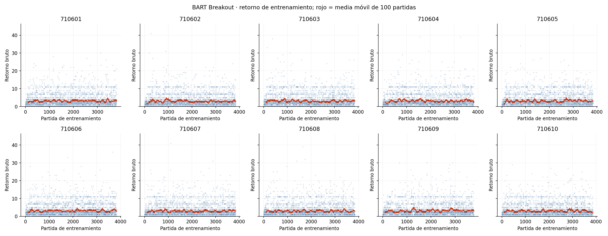
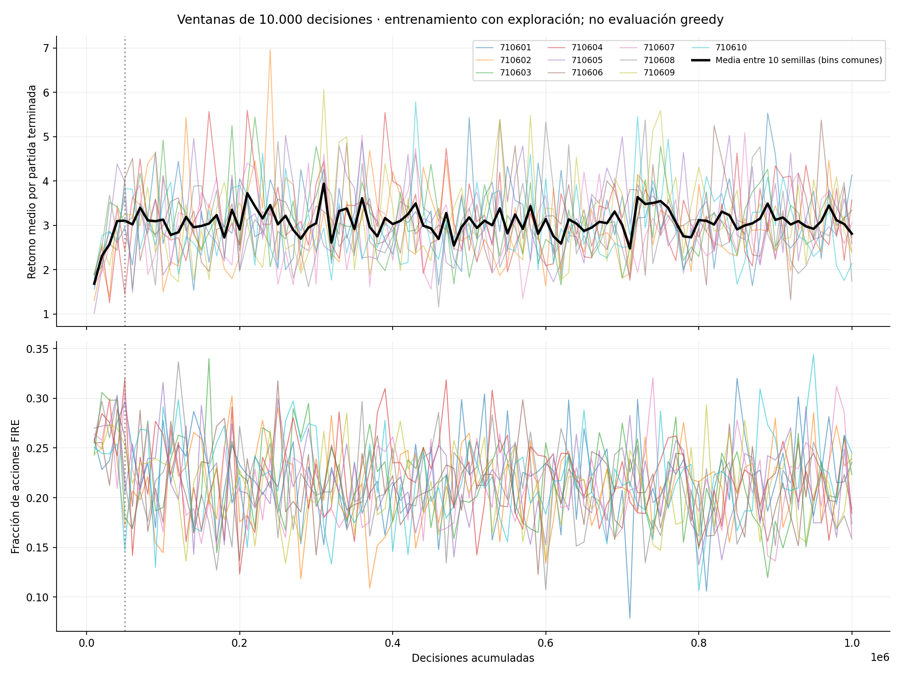
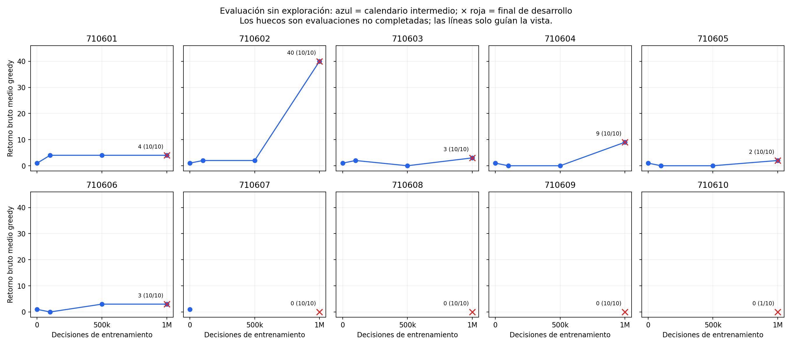
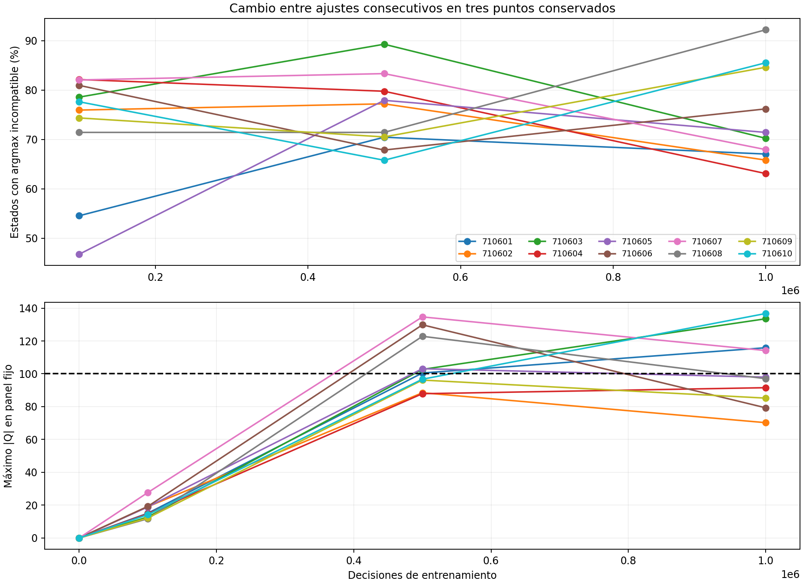

# BART en Breakout: diez semillas, evolución y consistencia

Análisis del 1 de noviembre de 2026. Se descargaron, con autorización, únicamente artefactos de la campaña Breakout OCAtari 710601–710610. No se modificaron modelos ni se ejecutaron entrenamientos, evaluaciones nuevas o test reservado. Esta instantánea es posterior a `results_cluster/breakout_1m_latest` y no lo sobrescribe.

## Resultado principal

Hay mejora inicial del retorno de entrenamiento y luego una meseta alrededor de tres puntos por partida. Las políticas greedy finales son muy variables entre semillas. Los modelos cambian notablemente su ranking de acciones entre inferencias consecutivas y aparecen predicciones fuera de una cota válida de retorno. Es evidencia de inestabilidad funcional y de valoración; no identifica por sí sola si el origen dominante es MCMC, el bootstrap, el replay o la representación.

Los diez agentes alcanzaron 1M de decisiones. Se verificaron **10 millones de transiciones, 19.829 segmentos comprometidos, 19.530 ajustes y 38.314 partidas terminadas naturalmente**. No hubo truncaciones durante entrenamiento. Nueve agentes tienen sus diez episodios finales de desarrollo; 710610 tiene uno completo y otro parcial en la descarga. Las evaluaciones futuras no están imputadas como cero.

Receta: cuatro acciones; 20 árboles por acción; ajuste cada 512 decisiones; replay FIFO de 50k; lote hasta 128 por acción; gamma .99; epsilon 1→.1 a 50k decisiones; 50 sweeps de burn-in y 50 retenidos; grow/prune; profundidad máxima 4; mínimo dos observaciones por hijo. Cada ajuste reinicia los árboles y conserva el prior de estructura/hojas; la calibración inicial del ruido se reutiliza.

## Retornos por partida y por decisiones



Puntos: retornos brutos de partidas completas. Rojo: media móvil de las últimas 100 partidas. Las escalas son compartidas. Esto mide la política de entrenamiento con exploración y cambios de modelo, no una política greedy congelada.

El promedio entre semillas de las primeras 100 partidas es **1,970** y el de las últimas 100 es **2,924**. Mejoran nueve de diez semillas; el cambio pareado es +0,954. Bootstrap descriptivo sobre diez semillas: intervalo percentil 95 % [0,639; 1,249]. La exploración y distribución de estados cambian, por lo que no es un contraste causal contra un agente aleatorio.



En bloques de 100k decisiones, la media entre agentes es:

`2,759 → 2,935 → 3,098 → 3,114 → 3,002 → 3,027 → 2,936 → 3,113 → 3,085 → 3,035`.

Hay progreso temprano, pero no una mejora sostenida entre aproximadamente 200k y 1M. Cada ventana atribuye una partida al movimiento donde termina; la media negra da igual peso a cada semilla. No se presentan 38 mil partidas como 38 mil agentes independientes.

## Evaluación sin exploración



Azul: dos episodios del calendario intermedio. Cruz roja: media final de desarrollo, con su denominador. Los huecos son datos no completados, no retornos cero. Las líneas solo guían la vista entre checkpoints observados. No puede localizarse cuándo ocurrió una mejora o caída dentro de intervalos tan amplios.

La semilla 710602 pasa de 2 puntos a 500k a 40 a 1M. 710603 cae a cero a 500k y recupera 3; 710604 obtiene cero a 100k/500k y termina en 9. Son snapshots irregulares, no una trayectoria monotónica. La buena evaluación final de 710602 no demuestra que mantenga 40 puntos en inferencias vecinas.

| Semilla | Partidas entrenamiento | Primeras 100 | Últimas 100 | Retorno greedy final | Eval. | Cambio greedy último ajuste¹ | Máx. |Q| panel |
| --- | --- | --- | --- | --- | --- | --- | --- |
| 710601 | 3801 | 1.97 | 3.69 | 4 | 10/10 | 67.0 % | 115.87 |
| 710602 | 3839 | 1.70 | 2.87 | 40 | 10/10 | 65.8 % | 70.23 |
| 710603 | 3858 | 2.00 | 3.15 | 3 | 10/10 | 70.2 % | 133.52 |
| 710604 | 3823 | 2.19 | 2.76 | 9 | 10/10 | 63.1 % | 91.54 |
| 710605 | 3834 | 1.43 | 2.97 | 2 | 10/10 | 71.4 % | 97.97 |
| 710606 | 3830 | 2.05 | 3.00 | 3 | 10/10 | 76.2 % | 79.30 |
| 710607 | 3846 | 1.85 | 3.01 | 0 | 10/10 | 67.9 % | 114.16 |
| 710608 | 3835 | 2.21 | 2.83 | 0 | 10/10 | 92.2 % | 97.04 |
| 710609 | 3777 | 2.18 | 2.92 | 0 | 10/10 | 84.6 % | 85.19 |
| 710610 | 3871 | 2.12 | 2.04 | 0 | 1/10 | 85.5 % | 136.72 |

¹ Cambio entre modelos 1952 y 1953, después de los ajustes de 999.424 y 999.936 decisiones. Se usa un panel fijo propio de cada semilla, de 76–88 estados observados, sin ponderación de visitas. Un cambio significa que los conjuntos de acciones maximizadoras no se intersectan. No es el porcentaje de tiempo real en que la política cambia.

La media de los nueve agentes completamente evaluados es **6,778**, y la mediana es **3**. Un único agente aporta 40 de los 61 puntos sumados entre esas nueve medias. No corresponde presentar una media final cerrada de diez agentes. Dentro de cada agente, los episodios completos repiten retorno y duración: la diversidad efectiva de evaluación es limitada y no son diez entrenamientos independientes.

## Por qué los ceros no contradicen las curvas de entrenamiento

710607, 710608 y 710609 completan diez evaluaciones con retorno cero y llegan siempre al horizonte de 27.000 decisiones sin FIRE. La única partida completa de 710610 tiene el mismo patrón. Duración alta aquí no significa jugar bien: hay ciclos de movimiento lateral.

Además de los conteos de acciones, se inspeccionó el estado exacto registrado al reiniciar una partida en el replay final (`step_id=0`). En 710608, Q(FIRE)=88,277 y Q(RIGHT)=90,728; el modelo elige RIGHT. El modelo anterior prefería LEFT. En 710609, Q(FIRE)=75,998 y Q(LEFT)=77,534. Estos rankings explican que el agente no ejecute FIRE al comenzar, aunque no prueban por sí solos toda la trayectoria posterior. Los conteos completos muestran que no llega a ejecutar FIRE en evaluación.

Durante entrenamiento, epsilon=.1 proporciona FIRE exploratorio con probabilidad .025 por decisión, incluso si no es greedy. Además, cada 512 movimientos cambia el modelo. Ambas cosas pueden sacar al agente de un ciclo que una evaluación greedy congelada mantiene. La frecuencia FIRE durante entrenamiento ronda valores mucho mayores que .025 en muchas ventanas: no debe atribuirse todo el retorno positivo exclusivamente a la exploración.

710606 muestra la cautela inversa: su primera acción es NOOP por un margen diminuto sobre FIRE (0,074), pero luego obtiene 3 puntos. No elegir FIRE en el primer movimiento no implica necesariamente quedar atrapado para siempre.

## Árboles entre inferencias y consistencia funcional

Se conservaron checkpoints a 0, 100k, 500k, 999.936 y 1M. Los dos últimos contienen el mismo modelo; no son dos inferencias distintas. Cada checkpoint entrenado también contiene el modelo objetivo anterior, por lo que permite comparar un par de ajustes consecutivos a ~100k, ~500k y ~1M. No están disponibles todos los árboles de los 1.953 ajustes; los logs sí contienen diagnósticos de todos ellos.



En el último par, cambia la acción greedy en **63,1–92,2 %** de los estados de esos paneles. En la mejor semilla 710602 cambia 65,8 %, con RMSE de Q de 1,62. Su margen mediano entre las dos mejores acciones es apenas 0,237: variaciones pequeñas respecto al nivel de Q pueden cambiar muchas decisiones. En 710610 el RMSE es 10,85. Estas diferencias mezclan cambios de lote, objetivos y aproximación MCMC; no aislan ninguna causa.

Para comprobar que el resultado no proviene solo de estados raros, se repitió el último par en todos los estados únicos del replay final (150–158 por semilla), ponderados por sus 50.000 visitas. **Cambia la acción preferida en 50,6–97,6 % de las visitas.** Por semilla 601–610: `69,75; 50,60; 51,14; 62,92; 66,87; 58,68; 56,68; 97,56; 88,06; 96,39 %`. El RMSE ponderado es 0,880–7,177, con márgenes medios entre mejores acciones de 0,306–2,615. Es la distribución del replay de entrenamiento, no la distribución futura de evaluación. Los detalles están en `replay_weighted_consistency.csv`.

También cambia la distribución de reglas de los ensembles: distancia de variación total 0,41–0,63 en el último par. Es un histograma normalizado de preguntas, independiente de etiquetas de árboles; no equivale a una fracción de nodos reemplazados. El número de hojas por sí solo no distingue éxito y fracaso: el último draw de 710602 tiene 146 hojas sumadas entre sus 80 árboles; 710607 y 710609 tienen 173 y 154.

Un ejemplo real, 710602/RIGHT, ilustra las estructuras: en el modelo 1952 el árbol más grande del último draw empieza preguntando si la pelota estaba ausente en el paso previo; en el modelo 1953 el árbol seleccionado empieza preguntando si paleta y pelota no están en contacto. El segundo tiene contribuciones de hoja 0,873, −5,900, −2,255 y −12,347 en unidades Q. Son aportes de **un** árbol y un draw; deben sumarse con otros 19 árboles y promediarse entre muestras. Los árboles elegidos no representan una misma identidad persistente.

El detalle de esos árboles a 100k, 500k y 1M y del ajuste anterior está en [actual_trees.txt](actual_trees.txt). No se interpreta una pregunta sobre ausencia/contacto como una estrategia semántica completa. La intercambiabilidad de árboles hace que cambiar su identidad no implique necesariamente cambiar Q; por eso la medida principal es predictiva.

## Inflación de Q y objetivos fuera de escala

Con recompensas de aprendizaje en [-1,1] y gamma=.99, una cota conservadora del retorno descontado es [-100,100]. Esta cota se refiere al retorno descontado de recompensas transformadas, no al puntaje bruto de una partida. El prior gaussiano de BART y la normalización no imponen una restricción dura a las predicciones.

En los paneles finales se observa máximo |Q|=115,87 (710601), 133,52 (710603), 114,16 (710607) y 136,72 (710610). Hay sobrepaso real de la cota; no es únicamente un contador activado por redondeo. No se ha demostrado crecimiento ilimitado: algunas semillas bajan de más de 100 a menos de 100 entre checkpoints.

| Semilla | Primer ajuste fuera de escala | Fracción en toda la corrida | Fracción en últimos 100k |
| --- | --- | --- | --- |
| 710601 | 257536 | 25.66 % | 98.72 % |
| 710602 | 304128 | 1.23 % | 0.19 % |
| 710603 | 296448 | 7.45 % | 40.56 % |
| 710604 | 291328 | 12.68 % | 4.37 % |
| 710605 | 282112 | 30.26 % | 58.57 % |
| 710606 | 287232 | 4.03 % | 0.05 % |
| 710607 | 206336 | 18.99 % | 28.57 % |
| 710608 | 255488 | 20.14 % | 19.39 % |
| 710609 | 346112 | 11.70 % | 0.76 % |
| 710610 | 309760 | 1.92 % | 11.75 % |

El contador incluye evaluaciones de objetivos remuestreados y puede repetir una transición; no cuenta experiencias únicas. En los últimos 100k, 710601 tiene 98,72 % de objetivos fuera de escala, mientras la mejor semilla 710602 tiene 0,19 %. Esta asociación en diez semillas no demuestra una causa única. Los logs no contienen el signo y magnitud de cada objetivo histórico; los checkpoints sí permiten medir predicciones concretas, como se hizo aquí.

## Explicaciones teóricas y cómo discriminarlas

**Bootstrap y maximización.** El objetivo usa el máximo de cuatro predicciones aproximadas. Errores de estimación pueden introducir optimismo que alimenta objetivos posteriores. En una aproximación ilustrativa, un sesgo persistente satisface b(k+1)≈gamma b(k)+delta; con gamma=.99, su nivel sería delta/(1−gamma)=100 delta. No se estimó delta con estas corridas: es una explicación posible de niveles Q elevados sin una mejora paralela de retorno. La literatura de [fitted Q con árboles](https://jmlr.org/papers/v6/ernst05a.html) estudia precisamente la sucesión de regresiones; la [combinación de aproximación, bootstrap y datos off-policy](https://arxiv.org/abs/1812.02648) puede generar inestabilidad, sin que eso implique que todo algoritmo con esos componentes diverja.

**BART no preserva necesariamente el rango de los objetivos.** Un CART con medias en hojas, o el promedio ExtraTrees usado aquí, predice combinaciones convexas de sus etiquetas. La suma BART de contribuciones gaussianas no tiene esa misma garantía. Por ello puede introducir sobrepasos que el bootstrap reutiliza. Esto justifica una ablación nueva de restricción de Q y/o doble estimador; no asegura que mejore el puntaje.

**Reinicio y MCMC corto.** Cincuenta sweeps de burn-in y cincuenta retenidos pueden reconstruir estructuras de manera insuficiente. Warm start podría reducir costo de adaptación, pero también conservar un modo inadecuado. Estas corridas tienen una cadena por ajuste; no permiten un R-hat entre cadenas. La auditoría previa de Pong no certifica mala mezcla de estos diez agentes Breakout. Aceptar muchas propuestas no certifica convergencia.

**Márgenes y cobertura.** Los cambios de ranking pueden ser grandes cuando las acciones tienen valores cercanos. Lotes de 128 ejemplos por acción, replay móvil y una representación discreta pueden modificar la estimación en estados de inicio o raros. La posibilidad de aliasing es una hipótesis, no un hecho demostrado por esta auditoría.

Pruebas siguientes, sin alterar la cohorte congelada: (1) fijar X/y y referencias de los últimos ajustes de una semilla buena y otra atrapada, correr varias cadenas y medir error Monte Carlo de Q y ranking; (2) comparar cold/warm start en una secuencia idéntica de lotes y objetivos con igual presupuesto; (3) estudiar por separado una variante que limite sobreestimación; (4) evaluar ventanas de varios modelos vecinos, para saber si 40 puntos es estable o un snapshot favorable. Aumentar partidas, imponer FIRE o cambiar varios componentes juntos no permitiría aislar las explicaciones anteriores.

## Archivos y reproducción

- `combined_summary.csv`: tabla unificada por semilla.
- `episodes.csv`, `windows.csv`, `fits.csv`: evolución de entrenamiento y diagnósticos por ajuste.
- `evaluation_episodes.json`, `evaluation_history.csv`: evaluaciones realmente completadas.
- `checkpoint_predictions.csv`, `checkpoint_comparisons.csv`, `checkpoint_structures.csv`: predicciones, cambios y estructura.
- `checkpoint_summary.json`, `panel_*.npz`: definición de paneles y estados de reinicio.
- `provenance.json`: procedencia, hash de descarga y alcance de verificaciones.

Los datos fuente se conservan en `tmp/bart_analysis_20261101/remote` del workspace. Para regenerar, desde la raíz capstone:

```bash
python3 rrl_bayesian/analysis/bart_10_seeds_20261101/analyze_logs.py --root tmp/bart_analysis_20261101/remote --output tmp/bart_analysis_20261101/log_analysis
python3 rrl_bayesian/analysis/bart_10_seeds_20261101/plot_evaluation.py tmp/bart_analysis_20261101/remote tmp/bart_analysis_20261101/evaluation
rrl_bayesian/.venv/bin/python rrl_bayesian/analysis/bart_10_seeds_20261101/analyze_checkpoints.py --source tmp/bart_analysis_20261101/remote --output rrl_bayesian/analysis/bart_10_seeds_20261101
rrl_bayesian/.venv/bin/python rrl_bayesian/analysis/bart_10_seeds_20261101/analyze_replay_weighted.py --source tmp/bart_analysis_20261101/remote --output rrl_bayesian/analysis/bart_10_seeds_20261101
```

El script de checkpoints requiere las dependencias del repo y carga únicamente pickles propios previamente verificados. La validación de blobs, fronteras y metadatos no equivale a reejecutar el emulador ni a auditar la corrección de todo el entrenamiento original.
