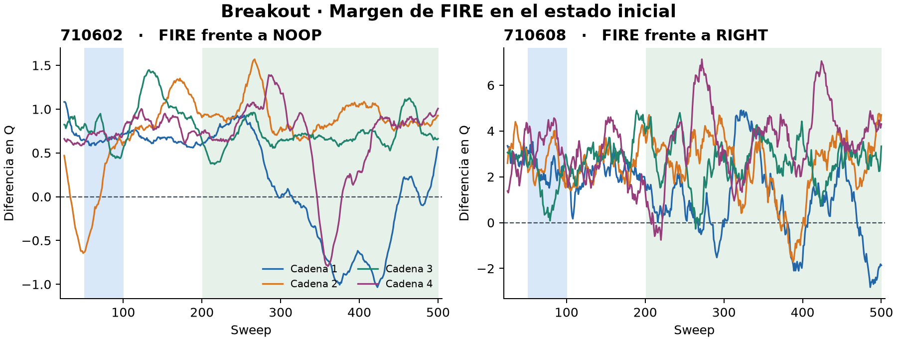

# BART en Breakout con los datos del último ajuste fijos

La evaluación greedy de desarrollo a 1M dio **6,10 puntos de media con BART** y **27,90 con el baseline histórico**. Cuatro semillas de BART obtuvieron cero en sus diez episodios y nunca ejecutaron `FIRE`. La semilla 710602 obtuvo 40 puntos y la 710608 obtuvo cero. Las elegimos como dos casos diagnósticos del mismo protocolo.

## Qué repetimos

Leímos los checkpoints finales verificados por SHA-256. En ambos, el último ajuste ocurrió en la decisión 999.936. Recuperamos los 128 estados codificados y sus objetivos TD por acción y verificamos el hash de cada lote, incluyendo los identificadores de transición. Usamos la misma escala, prior, calibración de ruido, número de árboles y propuestas que en el ajuste original.

Para cada semilla ejecutamos cuatro cadenas independientes por acción desde stumps. Comparamos los sweeps 51–100, que reproducen el presupuesto original de 50 de burn-in y 50 retenidos, con los sweeps 201–500 de esas mismas cadenas. En cada ventana la decisión greedy usa la media de las muestras de Q. Medimos también el margen entre `FIRE` y su rival más fuerte por Q posterior medio. El panel contiene el estado inicial de las partidas del replay y hasta 16 estados codificados frecuentes. Se trata de dos ajustes fijos y un panel descriptivo, con semillas elegidas por contraste de resultados. La evaluación del rendimiento en juego requiere episodios separados.

## Qué contenían los datos en el arranque

En 710608, el replay final tenía 192 visitas al estado exacto de inicio, 93 de ellas con `FIRE`. En el lote de 128 filas por acción solo quedaron **tres** ejemplos del estado inicial con `FIRE` y **cero** con cada otra acción. En 710602, el replay tenía 197 visitas iniciales, 140 con `FIRE`, y ningún lote final tenía un ejemplo exacto de ese estado.

Reconstruimos de forma descriptiva los objetivos de las transiciones de inicio en el replay final con el modelo objetivo original. La recompensa inmediata fue cero para las cuatro acciones en ambas semillas. Los objetivos fueron iguales entre todas las transiciones de cada acción dentro de cada semilla.

| Semilla | Objetivo TD de `FIRE` | Mejor objetivo de otra acción | Q final de `FIRE` | Mejor Q final de otra acción | Acción greedy publicada |
| --- | ---: | ---: | ---: | ---: | --- |
| 710602 | 67,02 | 65,98 (`RIGHT`) | 66,79 | 66,00 (`NOOP`) | `FIRE` |
| 710608 | 88,44 | 85,08 (`LEFT`) | 88,28 | 90,73 (`RIGHT`) | `RIGHT` |

Para 710608, la preferencia por `FIRE` en estos objetivos sí existía. El modelo ajustado sobre el lote publicado ordenó las acciones de otra manera. El lote escaso en estados iniciales permite que la predicción se apoye en estados con otras combinaciones de relaciones. El conteo por coincidencia exacta no mide el soporte total de las hojas de BART.

## Qué cambió al repetir el muestreo

| Semilla | Cadenas que eligen `FIRE` con 50 + 50 | Cadenas que eligen `FIRE` con 200 + 300 | Margen de `FIRE` con la media conjunta extendida | Estados del panel con desacuerdo entre cadenas extendidas |
| --- | ---: | ---: | ---: | ---: |
| 710602 | 3/4 | 2/4 | +0,57 sobre `NOOP` | 11/17 |
| 710608 | 3/4 | 4/4 | +2,42 sobre `RIGHT` | 6/17 |

En 710608, cuatro cadenas con los mismos datos y el presupuesto original ya producen dos acciones distintas. Con el presupuesto extendido, las cuatro medias posteriores eligen `FIRE`, con ventajas sobre `RIGHT` de 0,74 a 3,78 unidades Q. El muestreo por sí solo puede cambiar la decisión inicial. El presupuesto extendido tampoco estabiliza todas las predicciones. La estimación de Q para `RIGHT` en ese estado da \(\hat R=1{,}184\) y un tamaño efectivo bulk de 20 entre 1.200 muestras retenidas. En 710602, Q de `RIGHT` varía de 60,60 a 69,08 entre medias de cadenas extendidas y tiene \(\hat R=1{,}256\), con tamaño efectivo bulk de 12.

La varianza residual puede aparentar estabilidad mientras el orden de las acciones sigue variando. En la ventana extendida, el \(\hat R\) de \(\sigma^2\) para `FIRE` fue 1,012 en 710602 y 1,002 en 710608. El \(\hat R\) del margen contra el mejor competidor por media conjunta fue 1,213 y 1,026, respectivamente. Todos los objetivos guardados en estos dos ajustes estaban dentro de la cota de retorno descontado, aproximadamente [−100, 100]. La inflación de Q observada en otras semillas y momentos merece su propia prueba.

El sombreado azul marca los sweeps 51–100 y el verde los sweeps 201–500. El gráfico usa un rival fijo por semilla, seleccionado por la media posterior conjunta en la ventana extendida. Las escalas verticales son distintas. La tabla calcula la acción greedy contra las cuatro acciones.

## Qué probar ahora

1. Evaluar en Breakout las políticas congeladas de los nuevos ajustes en el mismo calendario de desarrollo. Medir `FIRE` al inicio y después de perder una vida, retorno, truncaciones y tiempo. El cambio de acción en el estado inicial todavía carece de una medición de puntaje.
2. Comparar el reinicio desde stumps, un warm start desde el ajuste anterior con validación del soporte de cada árbol, y cadenas cortas independientes con presupuesto comparable. Usar los mismos lotes y objetivos para cada variante. Medir la dispersión de márgenes, el desacuerdo de acciones y el costo antes de entrenar en línea.
3. Aislar la cobertura del replay. Conservar 128 ejemplos por acción y fijar una cuota de estados sin pelota para ver cuánto cambia la decisión sin cambiar el muestreador. Medir la elección de `FIRE` tanto en estados representados en el lote como en otros estados de servicio, y evaluar el retorno en episodios de desarrollo.

## Artefactos y reproducción

- [Semilla 710602](710602/report.json) y [semilla 710608](710608/report.json). Incluyen hashes de los lotes, valores Q por cadena, diagnósticos y configuración. Cada carpeta contiene `traces.npz` con las muestras de Q, \(\sigma^2\), error cuadrático, hojas, profundidad y duración del ajuste.
- [Script de auditoría](../../experiments/audit_breakout_bart_checkpoints.py). Ejecutar desde `rrl_bayesian/` con `python -m experiments.audit_breakout_bart_checkpoints --source ../tmp/bart_analysis_20261101/remote --output RUTA_NUEVA --seed 710602` y repetir para `710608`.
- La auditoría se ejecutó en macOS arm64 con Python 3.12.14 tras el rechazo por cuota en el cluster. NumPy 1.26.4 y SciPy 1.12.0 coinciden con el entorno histórico de Linux. Usamos semillas nuevas para las cadenas sobre los lotes guardados, y los tiempos reportados corresponden al Mac.
