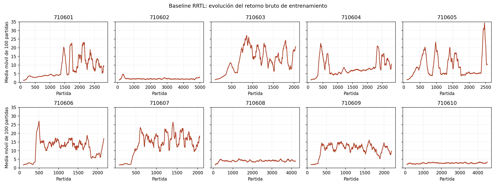
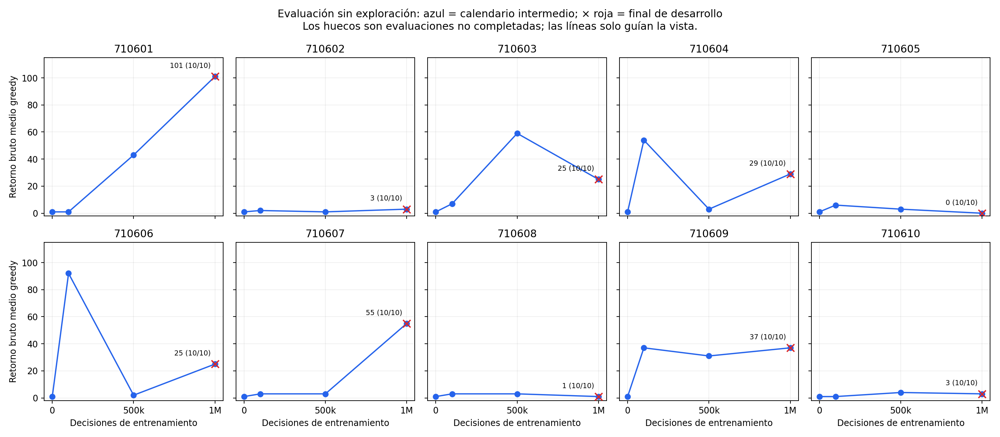
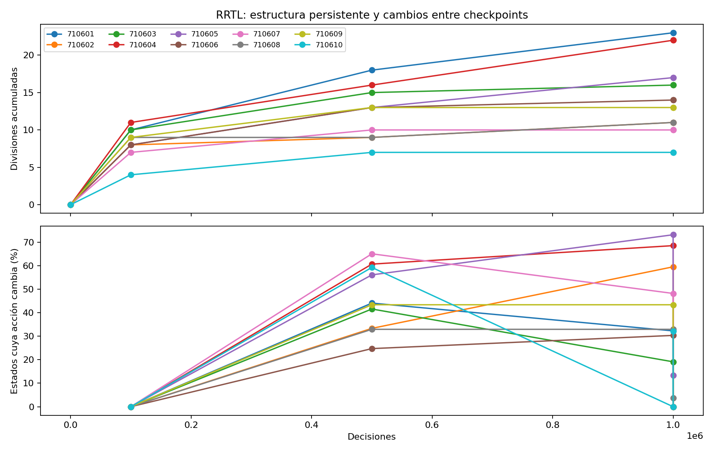

# Baseline RRTL: diez semillas de Breakout

Análisis terminado el 2 de noviembre de 2026. Fuente autorizada: kraken.ing.puc.cl, cuenta natan.brugueras, archive/rrl_bayesian_breakout_1m_20261028/corrected_common. Copia local tmp/baseline_analysis_20261101/remote. No se cambió el algoritmo, entrenó ni evaluó de nuevo. La receta de esta cohorte es historical_f, no la variante ANOVA añadida posteriormente al código.

## Evidencia y resultados

Se verificaron hashes, continuidad y conteos de 10 millones de transiciones en 19.586 segmentos. Hay 30.314 partidas terminadas, sin truncaciones de entrenamiento; 100 evaluaciones finales completas. Media entre los diez agentes 27,9, mediana25. Las diez evaluaciones de cada agente repiten retorno y duración: diversidad efectiva limitada, no100 entrenamientos independientes.

| Semilla | Partidas | Primeras 100 | Últimas 100 | Eval. final | Divisiones |
|---|---:|---:|---:|---:|---:|
| 710601 | 2815 | 1.22 | 9.14 | 101 | 23 |
| 710602 | 4985 | 1.32 | 2.99 | 3 | 11 |
| 710603 | 2036 | 1.61 | 20.68 | 25 | 16 |
| 710604 | 2811 | 1.33 | 10.59 | 29 | 22 |
| 710605 | 2552 | 1.54 | 10.40 | 0 | 17 |
| 710606 | 2158 | 1.72 | 17.03 | 25 | 14 |
| 710607 | 2048 | 1.74 | 18.45 | 55 | 10 |
| 710608 | 4204 | 1.77 | 3.93 | 1 | 11 |
| 710609 | 2193 | 1.97 | 9.78 | 37 | 13 |
| 710610 | 4512 | 2.04 | 3.43 | 3 | 7 |

Promedio entre semillas de primeras100 partidas1,626 y últimas10010,642. Diferencia pareada+9,016; bootstrap por semillas95%[5,445;12,804], descriptivo porque exploración y estados cambian. Las diez mejoran en esa comparación, pero602608610 permanecen cerca de3–4 puntos. No hay aprendizaje robusto en todas las semillas.

Ejemplos:601:1→43→101 en100k/500k/1M;603:7→59→25;604:54→3→29;606:92→2→25;605:6→3→0. Las líneas solo guían la vista entre mediciones. La variación no demuestra que una división específica cause una caída. La evaluación final es desarrollo, no test reservado.

710608 ejecuta FIRE una sola vez por partida y logra1punto; después llega a27k decisiones.710605 termina naturalmente con0puntos y sí ejecutaFIRE, por lo que no es el mismo fallo de ausencia total deFIRE detectado en BART. Entrenamiento positivo puede coexistir con política greedy mala: exploración y ajustes continuos pueden escapar de trayectorias que la política congelada repite.

## Árboles y consistencia

El baseline no tiene episodios periódicos de inferencia: hace TD y considera crecimiento tras cada transición. Se verificaron checkpoints0/100k/500k/999936/1M. Todas las reglas internas anteriores permanecen idénticas en sus mismas rutas; solo se añaden divisiones. A1M hay7–23 divisiones y15–47 hojas totales entre cuatro árboles; profundidades2–4.601 crece0→10→18→23 divisiones,6070→7→10→10,6100→4→7→7. La ausencia de crecimiento no implica valores congelados.

Para Q se usó el mismo panel fijo por semilla derivado de estados observados de la campaña BART previa, más los estados de colector baseline guardados. Es una referencia externa no ponderada, no distribución de visitas baseline. La medida de cambio usa conjuntos argmax para no contar desempates como cambio. En el tramo999936→1M hay64 actualizaciones, no512; no comparar sus porcentajes directamente con BART. Los árboles sí permanecen estructuralmente iguales en ese tramo, pero las políticas pueden cambiar con Q. Los CSV contienen medidas y árboles completos en trees.txt.

En el panel final Q está aproximadamente entre0,77 y2,42 según semilla/acción, muy por debajo de la cota100. Esto no contradice puntajes brutos de101: Q predice recompensas sign transformadas y descontadas, no puntaje bruto. La actualización convexa TD y la herencia mantienen acotados los valores a partir de una inicialización acotada; ello no prueba convergencia ni política óptima.

La semilla608 pone la trayectoria horizontal de la paleta en la raíz de NOOP,FIRE,RIGHT; LEFT comienza con posición horizontal paleta/pelota.610 también usa trayectoria de paleta paraRIGHT. Hay reglas potencialmente útiles y otras que pueden reflejar correlaciones con acciones previas; una raíz por sí sola no explica causalmente el resultado. En varias semillas la presencia de pelota ocupa raíces y permite distinguir fases de juego que el artículo eliminaba del estado.

## Comparación con paper_base.pdf

Se leyó el documento local Learning Rules from Rewards, arXiv2203.13599v4,28nov2025, especialmente secciones2.1.1/2.2/3.1/3.2 y discusión, Figuras4–6 (páginas5–11). Se renderizaron páginas8–10 para inspeccionar curvas y árboles.

**Concordancia cualitativa:** el paper reporta selección de relaciones útiles, semillas exitosas y semillas planas o que pierden rendimiento. Reconoce explícitamente que no poder revertir divisiones subóptimas limita RRTL (pp7,11). Nuestras curvas heterogéneas, retrocesos y estructura irreversible son compatibles. No se demostró una relación causal entre una división y una caída concreta.

**No es reproducción cuantitativa:**

| Aspecto | Paper | Esta campaña |
|---|---|---|
| Agentes |100 semillas por versión|10,solo comparativa con relaciones lógicas auxiliares|
| Presupuesto Breakout |2M iteraciones|1M decisiones|
| Mínimo para dividir |100.000|128 (el código exige superar el mínimo)|
| Profundidad |10|4|
| Exploración1→.1 |500k pasos|50k|
| Relaciones Breakout |4comparativas:posiciónx/y y movimientox/y pelota|11:incluye movimiento paleta,presencia,contacto|
| Extracción/tolerancia espacial |visual,6px|OCAtari RAM,4px|
| Estados sin pelota |vacíos,acción aleatoria incluso greedy|presencia explícita y fallback interno;sin esa regla aleatoria|
| Buffer anti repetición |10acciones en Breakout|desactivado|
| Checkpoint evaluado |guardado al récord de retorno de entrenamiento|final a1M|
| Evaluación |100partidas/agente|10partidas/agente|

Compartimos eta.025,gamma.99,recompensa sign y nivel.0001. El código histórico usa FireReset y una actualización TD que consulta el estado actual en vez del siguiente; el baseline corregido usa el siguiente estado y terminales explícitos. Es otra razón para no equiparar bytes históricos, ecuación del paper y nuestra cohorte.

El paper informa mediana human-normalized2,011 para comparativo Breakout frente.722 lógico, y70/100agentes al nivel humano o superior. Nuestra mediana bruta25 no se compara directamente con2,011. Usando como referencia contextual la normalización del script histórico (R−1,7)/(31,8−1,7), nuestra mediana equivale.774 y3/10agentes superan31,8. Estos umbrales provienen de otro protocolo Atari; son contexto, no reproducción de benchmark humano. No probamos aquí superioridad comparativa frente lógica porque no corrimos variante lógica.

Figura4 tiene una ambigüedad de escala: su caption habla de retornos normalizados, pero el código histórico de curvas agrega Return de recompensas transformadas sin normalización humana. Nuestras curvas son explícitamente puntaje bruto. No superponer magnitudes de entrenamiento como si fueran métricas idénticas.

## Interpretación y próximos experimentos

RRTL aprende políticas útiles con una representación pequeña, pero la estructura persistente no implica estabilidad de rendimiento. El mínimo128 hace admisibles decisiones con mucha menos evidencia que100k; explorar diez veces más rápido puede fijar antes sesgos de visita. Son mecanismos plausibles de dependencia de semilla; no causas aisladas experimentalmente. El límite4 podría restringir capacidad, pero varios agentes malos solo alcanzan2: no basta aumentar profundidad.

Prioridades: variar mínimo de muestras manteniendo lo demás fijo; comparar F histórico/ANOVA; probar revisión de divisiones como variante separada; medir varios checkpoints vecinos y guardar mejor política mediante validación independiente de test. Para evaluar concordancia exacta con el paper habría que restablecer representación, presupuesto y protocolo completos; no modificar esta cohorte congelada.

## Reproducción y límites

analyze_logs.py valida fronteras de logs y produce episodes/windows/training_summary; plot_evaluation.py valida identidades; analyze_checkpoints.py valida SHA de pickle y metadata antes de cargar modelos propios. Cargar checkpoint para análisis no restaura el emulador. No se reejecutaron episodios. Fuente PDF: /Users/natanzamorano/Documents/Universidad/capstone/paper_base.pdf. Archivos brutos autorizados en tmp/baseline_analysis_20261101/remote. Los scripts se ejecutan desde la raíz capstone; las rutas de análisis están fijadas a esta auditoría.
