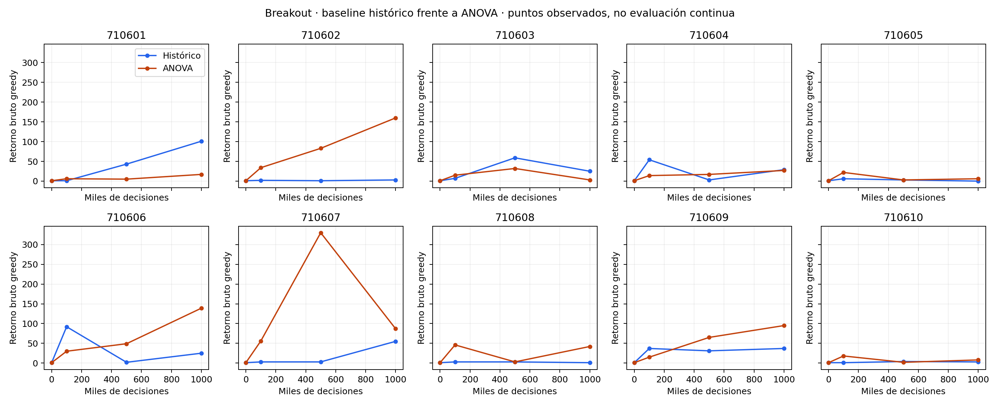
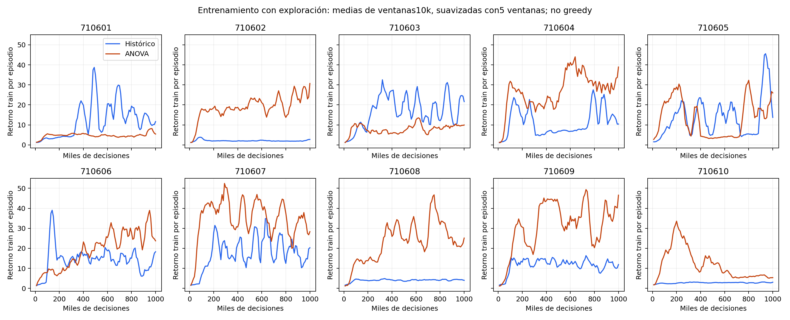
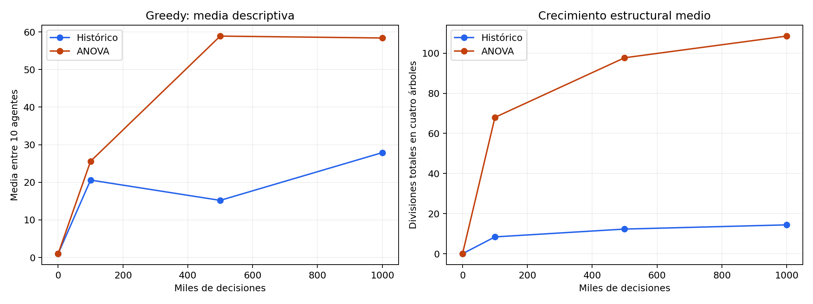

# Breakout: aprendizaje del baseline histórico y de RRTL-ANOVA

Auditoría del 6 de noviembre de 2026. Se comparan diez semillas por método, 710601–710610, hasta **1.000.000 de decisiones por agente**. Este documento distingue observaciones de mecanismos posibles y de experimentos necesarios. No se cambió el algoritmo ni se enviaron nuevos entrenamientos durante esta revisión.

## Resultado principal

**Ambos métodos aprenden, ANOVA obtiene mejores resultados finales medios en esta cohorte, y ninguno garantiza una mejora sostenida por semilla.** La media final pasa de 27,9 a 58,4 puntos brutos y la mediana de 25 a 34,5. ANOVA mejora siete semillas y empeora tres. Su ventaja no demuestra todavía una política consistentemente mejor: la incertidumbre entre diez agentes es amplia, hay caídas pronunciadas durante el entrenamiento y la evaluación ofrece poca diversidad efectiva de partidas.

Los jobs ANOVA 36273, 36274_0–4 y 36275 terminaron `COMPLETED`, salida 0; el cierre declara calendario completo hasta 1M. `status.state="partial"` con `reason="authorized_milestone_reached"` corresponde a la autorización de 1M dentro de un protocolo cuyo máximo futuro es 2M, no a un fallo del entrenamiento.

## Qué se está comparando

Se conservan entorno Breakout OCAtari RAM, cuatro acciones, once relaciones, recompensa `sign(raw_reward)`, TD con eta .025 y gamma .99, exploración exponencial de 1 a .1 en 50k decisiones, mínimo 128, profundidad 4 y umbral nominal .0001. Hay cuatro árboles por agente, uno por acción. La evaluación usa la política greedy congelada y suma puntaje bruto sin descuento; el entrenamiento explora y continúa actualizando Q.

El runtime congelado coincide: Python 3.11.7, NumPy 1.26.4, SciPy 1.12.0, OCAtari 2.2.1, Gymnasium 1.1.1 y ALE .10.2, con un thread numérico. La revisión de las fuentes antiguas recuperadas por SHA y las nuevas no encontró cambios simultáneos de recompensa, TD, representación, dinámica ni evaluación de desarrollo. Las diferencias adicionales son validación de checkpoints, operación y análisis. Véase [auditoría de fuentes](source_audit.md). El exportador pareado estricto exige igualdad literal de fuentes y no se utilizó para certificar estas campañas: la comparación aquí está alineada y auditada, pero no se saltan sus protecciones.

Se revisaron las unidades de evaluación y sus identidades/hashes, los pesos retenidos y sus metadatos antes de deserializar checkpoints propios. Se dispone de pesos en 0/100k/500k/999936/1M, no en todas las fronteras intermedias de guardado. Los árboles se analizan estáticamente: no se restauró el emulador para obtener resultados nuevos.

## Resultados por semilla y retrocesos

Cada celda muestra retorno bruto greedy a **100k → 500k → 1M**. Los puntos intermedios tienen dos episodios; el punto final tiene además diez episodios de desarrollo con otras semillas. En esta campaña repiten el mismo retorno por agente y checkpoint. Las líneas de las figuras solo unen observaciones; no describen el rendimiento entre ellas.

| Semilla | Histórico | ANOVA | Diferencia final ANOVA−histórico |
|---|---:|---:|---:|
| 710601 | 1 → 43 → 101 | 6 → 5 → 17 | −84 |
| 710602 | 2 → 1 → 3 | 34 → 83 → 160 | +157 |
| 710603 | 7 → 59 → 25 | 15 → 32 → 3 | −22 |
| 710604 | 54 → 3 → 29 | 14 → 17 → 27 | −2 |
| 710605 | 6 → 3 → 0 | 22 → 3 → 6 | +6 |
| 710606 | 92 → 2 → 25 | 30 → 49 → 139 | +114 |
| 710607 | 3 → 3 → 55 | 56 → 330 → 87 | +32 |
| 710608 | 3 → 3 → 1 | 46 → 3 → 42 | +41 |
| 710609 | 37 → 31 → 37 | 15 → 65 → 95 | +58 |
| 710610 | 1 → 4 → 3 | 18 → 2 → 8 | +5 |



| Indicador | Histórico | ANOVA |
|---|---:|---:|
| Media a 100k | 20,6 | 25,6 |
| Media a 500k | 15,2 | 58,9 |
| Media a 1M | 27,9 | 58,4 |
| Mediana a 1M | 25 | 34,5 |
| Desviación estándar entre agentes a 1M | 31,48 | 58,02 |
| Agentes con retorno final ≤3 | 4/10 | 1/10 |
| Agentes que terminan por debajo de algún checkpoint previo observado | 6/10 | 5/10 |
| Evaluaciones finales limitadas por horizonte | 10/100, todas de 710608 | 0/100 |

ANOVA 710602, 710604, 710606 y 710609 mejoran en los tres puntos posteriores a cero. Otras trayectorias son distintas: 710607 ya alcanza una política de 330 puntos a 500k y pierde 73,6% de ese retorno a 1M; 710603 pierde 90,6% de 32 a 3; 710608 cae y se recupera parcialmente; 710605 y 710610 permanecen bajos después de sus máximos tempranos. El promedio ANOVA se mantiene entre 500k y 1M, pero esconde ganancias y deterioros individuales muy distintos. Que el máximo observado sea mejor que el final no autoriza reportarlo como desempeño de test de un selector de checkpoints.

La diferencia media final es **+30,5** puntos. Bootstrap descriptivo pareado por semilla, 100.000 remuestreos, da IC95% **[−8,6;71,4]**. El signo favorece ANOVA en 7/10, con test de signos exploratorio bilateral p=.34375. Las dos ganancias mayores aportan 271 de los 305 puntos netos de diferencia; retirarlas retrospectivamente deja +4,25 entre las ocho restantes. Esta sensibilidad no invalida sus éxitos, pero muestra por qué la media sola no basta. Véase [estadísticas reproducibles](comparison_stats.json). No se usa p>.05 como prueba de equivalencia.

La desviación estándar absoluta mayor de ANOVA tampoco demuestra por sí sola mayor inestabilidad temporal: compara dispersión entre agentes que además tienen distinta escala media. Para estabilidad durante el aprendizaje importan las trayectorias, la frecuencia y tamaño de retrocesos y evaluaciones con diversidad suficiente.

## Recompensas durante los episodios de entrenamiento

Se verificaron **20 millones de transiciones**, la continuidad y SHA de **39.163 segmentos** de logs comprometidos. Hay **30.314 partidas terminadas históricas y 20.093 ANOVA**, sin truncaciones de entrenamiento. Cada agente histórico jugó 2.036–4.985 partidas y cada ANOVA 1.202–3.491; el presupuesto común es decisiones, no número fijo de partidas. Menos episodios puede acompañar partidas más largas.

| Semilla | Histórico: primeras100 → últimas100 | ANOVA: primeras100 → últimas100 |
|---|---:|---:|
| 710601 | 1,22 → 9,14 | 1,35 → 5,19 |
| 710602 | 1,32 → 2,99 | 1,17 → 28,28 |
| 710603 | 1,61 → 20,68 | 1,73 → 9,89 |
| 710604 | 1,33 → 10,59 | 1,17 → 32,72 |
| 710605 | 1,54 → 10,40 | 3,93 → 20,93 |
| 710606 | 1,72 → 17,03 | 3,13 → 24,18 |
| 710607 | 1,74 → 18,45 | 2,95 → 29,37 |
| 710608 | 1,77 → 3,93 | 1,46 → 23,02 |
| 710609 | 1,97 → 9,78 | 1,23 → 37,64 |
| 710610 | 2,04 → 3,43 | 1,80 → 5,35 |
| Media entre agentes | **1,626 → 10,642** | **1,992 → 21,657** |

Las diez semillas mejoran primeras frente a últimas cien en ambos métodos. Eso confirma progreso bajo la política exploratoria, pero no monotonía ni robustez greedy. Estas ventanas contienen cien episodios por agente, con distintas longitudes y localizaciones en decisiones; no son un experimento de intervención sobre epsilon.

También mejora la tasa de puntaje bruto durante el entrenamiento: primeras100k → últimas100k decisiones dan **13,676 → 22,697 puntos por mil decisiones** en histórico y **20,843 → 30,342** en ANOVA, agregando por igual un presupuesto de100k por semilla. La diferencia final entre métodos es aproximadamente34% en esta tasa; no confundirla con duplicar la media de retorno por episodio, que depende además de duración y terminación.

Hay retrocesos reales dentro del entrenamiento, además de las caídas greedy. ANOVA710610 promedia25,31 puntos por partida terminada entre100k–200k y solo5,47 en900k–1M. ANOVA710605 pasa25,79 a3,43 en400k–500k y luego17,37 al final: caída y recuperación parcial. ANOVA710607 alcanza43,99 en200k–300k y termina en31,67. Epsilon ya es.1 durante todos esos bloques, por lo que el calendario de exploración por sí solo no explica sus diferencias tardías. La distribución de estados, Q y la estructura sí siguen cambiando.

La discrepancia entrenamiento/evaluación es concreta: histórico710605 termina con media10,40 en sus últimas100 partidas de entrenamiento y greedy0; ANOVA710603 tiene9,89 y greedy3. La exploración puede evitar trayectorias malas y el aprendizaje dentro de una partida también cambia la conducta. Comparar políticas congeladas con epsilon distinto permitirá separar esos efectos. No se identificó aquí el mecanismo causal.



La figura asigna una partida al intervalo10k donde termina y suaviza las medias con cinco intervalos. El CSV de episodios conserva resultados sin suavizar y flags de terminación; no se confunde con una evaluación greedy.

## Qué muestran los árboles

| Estructura final, total de los cuatro árboles | Histórico | ANOVA |
|---|---:|---:|
| Divisiones por agente | 7–23; media 14,4 | 101–123; media 108,5 |
| Hojas por agente | 15–47; media 30 | 200–249; media 217,3 |
| Profundidad máxima | 2–4 | 4 en todos los agentes y acciones |
| Hojas situadas a profundidad 4 | 3,0% del total | 84,4% del total |
| Divisiones medias ya presentes a 100k | 8,4 | 68,0 |

ANOVA no es un retoque pequeño de un árbol del mismo tamaño: produce unas **7,5 veces más divisiones** y usa mucho más la profundidad disponible. A 100k ya tiene aproximadamente el 63% de sus divisiones finales. No sabemos el instante de cada división a partir de estos logs.



Con el máximo recuento entre candidatas como indicador de soporte acumulado desde que nació cada hoja, la mediana es 11.677 en histórico y 429 en ANOVA. ANOVA tiene 805/2.173 hojas con recuento ≤128 y 49 con cero; histórico 8/300 y ninguna con cero. Esos conteos no representan visitas de toda la vida del padre, se reinician en hijos y dependen de qué relaciones están disponibles. Algunas ramas pueden ser raras o físicamente inaccesibles; esta auditoría no comprobó la accesibilidad de cada una. No se concluye automáticamente que todas las hojas con poco soporte sean perjudiciales; sí se justifica medir soporte y calidad de las particiones antes de aumentar profundidad.

Las reglas de ambos métodos permanecen en su ruta entre checkpoints: **no existe poda, reemplazo ni revisión de una división**. Que el árbol no cambie no significa que Q ni la política estén congelados. Los hijos heredan Q del padre: la división tampoco cambia inmediatamente las predicciones; cualquier efecto aparece con las actualizaciones posteriores.

### Ejemplos interpretables y límites

En el histórico, RIGHT de 710610 nunca pregunta por posición horizontal paleta/pelota. Su estructura ya era esencialmente la misma a 100k:

```text
Movimiento horizontal previo de la paleta
├── derecha: Q≈1,058
├── quieta:  Q≈1,129
└── izquierda
    └── pelota presente en el instante anterior
        ├── sí: Q≈1,183
        └── no: Q≈1,055
```

Así, bajo esas condiciones de presencia y movimiento, RIGHT no puede valorar de forma distinta tener la pelota a izquierda o derecha. En nueve sondas sintéticas que cruzan posición horizontal y movimiento previo, esa política nunca elige RIGHT. No equivale a que jamás utilice RIGHT en el juego: sí aparece en sus registros y existen otros estados/fases. 710602 y 710608 presentan ramas con un problema semejante; las tres terminan históricamente en 3,1,3 puntos. No basta aumentar profundidad: sus máximos históricos son 3,2,2, por debajo del límite 4.

ANOVA 710602 y 710608 sí eligen RIGHT en las tres sondas con pelota a derecha de la paleta y diferentes movimientos previos; sus retornos finales son 160 y 42. En 710610 ANOVA todavía aparecen NOOP y FIRE bajo algunas de esas condiciones, y su retorno es 8. 710601 histórico, que obtiene 101, también empieza RIGHT preguntando por movimiento, pero sus descendientes recuperan posición relativa. Por tanto **el nombre de la raíz aislado no determina la calidad**: hay que leer rutas, Q de todas las acciones y condiciones realmente visitadas.

Una sonda mantiene pelota presente, movimiento abajo/derecha, paleta debajo, contacto falso y combina posición/movimiento de la paleta. Es una comprobación contrafactual de sensibilidad, no una política óptima certificada para toda geometría que satisface esos signos ni una trayectoria real. Los cuatro árboles compiten mediante argmax Q: mostrar solo el árbol RIGHT no explica por completo la acción.

El conjunto completo evita una lectura selectiva de esos ejemplos: con pelota a derecha, RIGHT aparece en 24/30 combinaciones ANOVA frente a 23/30 históricas; con pelota a izquierda, LEFT aparece en 23/30 frente a 27/30. Estas sondas tan simples no acreditan una mejora global del seguimiento ni explican por sí solas por qué 710607 cae de 330 a 87. Haría falta un panel de estados reales y situaciones variadas, ponderado por visitas o construido deliberadamente para cubrir fases.

El histórico 710608 ejecuta FIRE una vez, puntúa 1 y llega al límite de 27k decisiones. 710605 termina naturalmente con cero aunque sí usa FIRE. Son fallos distintos. ANOVA elimina la truncación final de 710608 en esta cohorte, pero no demuestra haber eliminado toda política de espera bajo otros arranques.

Los árboles y todas las Q están en [historical_trees.txt](historical_trees.txt) y [anova_trees.txt](anova_trees.txt); [nodes.csv](anova_nodes.csv), [sondas](anova_policy_probes.csv) y [cambios de política](anova_policy_changes.csv) permiten auditarlos sin usar solo ejemplos escogidos.

## Por qué puede mejorar ANOVA y aún perder rendimiento

Ambos actualizan una Q compartida por hoja y acción:

\[
y_t=r_t+\gamma m_t\max_a Q_t(s_{t+1},a),\qquad
q_{t+1}=q_t+.025(y_t-q_t).
\]

Después acumulan las estadísticas **de q actualizado**, no de targets individuales ni de retornos Monte Carlo. El histórico usa R=W/T con p=CDF_F(R;n−1,n−1); ANOVA usa F=[B/(K−1)]/[W/(n−K)] con p=SF_F(F;K−1,n−K). La segunda regla puede aceptar diferencias menores cuando hay suficientes observaciones; no son fórmulas equivalentes.

Por ejemplo, en RIGHT/quieta del histórico 710610, una candidata de posición horizontal tiene n=16.182: p histórico=.4126, pero al recalcular ANOVA sobre exactamente esos momentos se obtiene p≈6,33e−13, inferior al umbral .0001. Esto muestra una diferencia real de sensibilidad. No demuestra qué candidata habría ganado online ni que dividir esa rama hubiera mejorado la recompensa: después de cualquier cambio divergen las visitas y estadísticas futuras.

Los p son criterios nominales de crecimiento. Q temporalmente correlacionado, cambios de política, selección del mínimo entre candidatas y tests repetidos impiden atribuirles control de falsos positivos clásico. ANOVA conserva además el posible problema de que Q suavizado o tendencias temporales separen categorías de manera poco útil para predecir targets futuros.

Hay varias explicaciones compatibles con las caídas: Q puede cambiar el ranking en estados clave; ramas poco visitadas pueden conservar valores inadecuados; una partición irreversible puede limitar posteriores distinciones; y la política puede volverse dependiente de exploración para relanzar la pelota o salir de un ciclo. **No se ha demostrado overfitting ni identificado una división causalmente responsable de una caída concreta.** Los registros de transición no incluyen estado relacional ni eventos/rutas de split, de modo que no permiten reconstruir retrospectivamente toda esa cadena causal.

La recompensa tampoco es una instrucción explícita de nunca perder o ganar rápido: en Breakout se aprende con sign(puntaje) y descuento .99. No hay penalización añadida por vida perdida o decisión de espera. Perder todas las vidas termina el episodio y anula bootstrap; perder una vida invalida la historia de pelota, pero no es por sí mismo terminal TD. Q no estima el puntaje bruto final, por lo que Q≈1–3 puede coexistir con 100–330 puntos brutos. Mantener el objetivo y medir sus componentes antes de añadir shaping evita cambiar el problema sin saber qué falla.

## Qué experimentaría antes de modificar baseline

**1. Comprobar la política congelada bajo diversidad real y separar exploración de aprendizaje.** Usar pesos ya existentes de 100k/500k/1M. Construir un panel común de arranques o snapshots completos realmente diferentes; verificar objetos/RAM e historia del extractor. Evaluar epsilon 0,.01,.1 sin TD ni cambios de árbol. Registrar retorno, vidas, golpes/pérdidas, FIRE por fase, tiempo esperando lanzamiento, truncaciones y diversidad de trayectorias. Empezar con una selección explícita de agentes buenos, planos y que caen, y confirmar las conclusiones relevantes en los diez. Si epsilon rescata una política congelada, eso evidencia dependencia de exploración, no aprendizaje nuevo. Estas pruebas usan un protocolo diagnóstico separado y no sobrescriben las evaluaciones oficiales.

Las evaluaciones de las políticas ya entrenadas repiten retorno y duración dentro de cada agente. En el checkpoint cero, los desempates aleatorios producen duraciones distintas aunque todos los retornos son 1. Atari es determinista y el contrato desactiva sticky actions y no-ops aleatorios de inicio; cambiar solo el seed no asegura un desafío diferente. La [documentación oficial de ALE](https://ale.farama.org/v0.10.0/environments/) explica este problema y los mecanismos de estocasticidad. Una prueba con sticky actions requeriría soporte/protocolo nuevo en nuestro backend; no se activa silenciosamente en la campaña congelada. Aumentar de diez a cien copias del mismo episodio no resuelve esta limitación.

**2. Continuaciones cortas con observación densa, antes de otra campaña larga.** Registrar por decisión ruta/hoja/acción, Q de las cuatro acciones, margen entre las dos mejores, target y error TD, relaciones relevantes, fase de juego, vidas y presencia de pelota. Cada división debe guardar contador, literal, recuento por categoría, efecto B/T, p de ambas reglas y herencia de Q. Evaluar cada 10k–25k durante una continuación de 100k–250k y guardar esos pesos diagnósticos. Esto localiza cuándo cambia la conducta y si el cambio precede/sigue crecimiento o solo deriva de Q. Los checkpoints antiguos ausentes no pueden recrearse desde los JSONL sin estados.

**3. Separar causalmente estructura y actualización de valores.** Desde el mismo checkpoint verificado, crear continuaciones nuevas con procedencia explícita: crecimiento normal frente a árbol de estructura congelada, manteniendo TD, exploración y presupuesto. Usar los mismos arranques y varias continuaciones, incluyendo agentes buenos y malos; no alterar el checkpoint original ni eludir su contrato. Si ambas ramas se deterioran, congelar estructura no basta; si solo se deteriora la que crece y el efecto se repite, hay evidencia contra esa regla de crecimiento. En otra ablación, refinar una rama problemática por posición, heredando Q y dejando un período de aprendizaje antes de evaluar, prueba la partición concreta. No cambiar simultáneamente criterio, eta, epsilon y profundidad.

**4. Auditar la señal de split en un dataset común.** Recoger transiciones de comportamiento mixto y apartar episodios completos. Por hoja y candidata comparar Q actualizado, target y error TD, soporte por categoría, efecto B/T y ambos p. Comprobar si la división reduce error sobre targets congelados en episodios apartados y si importa para decidir acciones. Eso distingue falta de cobertura, una estadística insensible y asociaciones temporales que no generalizan. Un menor error Bellman por sí solo tampoco certifica mejor retorno.

**5. Verificar qué permite la representación de Breakout.** Comparar un controlador heurístico que solo utiliza las once relaciones con uno de coordenadas/velocidad y lanzamiento explícito; usar mismos arranques e informar recursos o memoria adicionales. Auditar codificaciones idénticas en situaciones físicas donde cambia la acción útil. Actualmente el agente solo recibe pelota/paleta, aunque OCAtari detecte ladrillos: no puede condicionar directamente en la configuración de ladrillos, velocidad métrica o distancia que se hayan descartado. Un heurístico relacional exitoso demuestra que es posible una política útil con esa información; uno malo no prueba imposibilidad. Las pruebas anteriores de heurísticos de Pong no sustituyen este control de Breakout.

Estas pruebas discriminan intervenciones: calendario de exploración/arranque si hay dependencia de FIRE; mínimo de muestras o tamaño del efecto si ANOVA fragmenta con poco soporte; otra señal de división si targets se separan pero Q no; revisión de ramas si la estructura es causal; representación si la información descartada cambia sistemáticamente la decisión. Solo después haría ablaciones pequeñas y aisladas y una confirmación a 2M. Los diez agentes y los episodios inspeccionados son desarrollo: conservar test independiente para la variante final.

La [evaluación de RL con pocas corridas de Agarwal et al.](https://proceedings.neurips.cc/paper_files/paper/2021/hash/f514cec81cb148559cf475e7426eed5e-Abstract.html) respalda informar incertidumbre entre entrenamientos en vez de basarse solo en medias puntuales. Aquí la unidad es la semilla entrenada, no cada episodio repetido.

## Reproducción y archivos

El [script de auditoría](audit.py) lee artefactos existentes, verifica integridad y exporta CSV, árboles y figuras. El [cálculo estadístico](comparison_stats.py) utiliza las evaluaciones auditadas y contrasta el cierre descargado. [Mecanismo y diseño detallado](mecanismo_y_experimentos.md) remite a las funciones de implementación. [Hallazgos de árboles ANOVA](anova_tree_findings.md) amplía los ejemplos y los límites de las sondas.

El informe no ejecuta políticas nuevas, no consume test reservado y no selecciona un mejor checkpoint con sus propios datos como si fuera test independiente.
