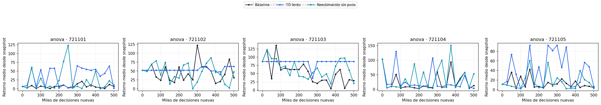

# Resultados de mejoras RRTL

Retornos incrementales desde snapshots; no son puntajes de partidas completas. Comparación exploratoria, sin test reservado.
Continuaciones completas: 15. Transiciones verificadas: 7,500,000.

| Criterio | Seed | Rol | Variante | Media final | Mediana final | Podas | Reemplazos | Refits |
|---|---:|---|---|---:|---:|---:|---:|---:|
|anova|721101|confirmation|Baseline|6.50|5.50|0|0|0|
|anova|721101|confirmation|TD lento|1.17|1.00|0|0|0|
|anova|721101|confirmation|Reestimación sin poda|10.58|12.50|0|0|19|
|anova|721102|confirmation|Baseline|31.17|33.50|0|0|0|
|anova|721102|confirmation|TD lento|63.00|69.50|0|0|0|
|anova|721102|confirmation|Reestimación sin poda|47.83|46.50|0|0|20|
|anova|721103|confirmation|Baseline|28.42|25.50|0|0|0|
|anova|721103|confirmation|TD lento|86.67|53.00|0|0|0|
|anova|721103|confirmation|Reestimación sin poda|20.08|14.50|0|0|15|
|anova|721104|confirmation|Baseline|12.75|12.00|0|0|0|
|anova|721104|confirmation|TD lento|3.50|3.00|0|0|0|
|anova|721104|confirmation|Reestimación sin poda|54.00|57.00|0|0|20|
|anova|721105|confirmation|Baseline|4.42|3.50|0|0|0|
|anova|721105|confirmation|TD lento|6.83|6.50|0|0|0|
|anova|721105|confirmation|Reestimación sin poda|3.00|3.00|0|0|19|

Los arranques de un mismo seed son dependientes. Los grupos de confirmación no se usaron para desarrollar estas revisiones, pero no son un benchmark ciego. Una media alta aislada no demuestra superioridad general.

