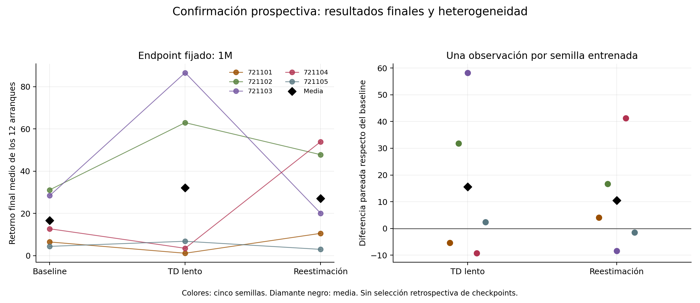
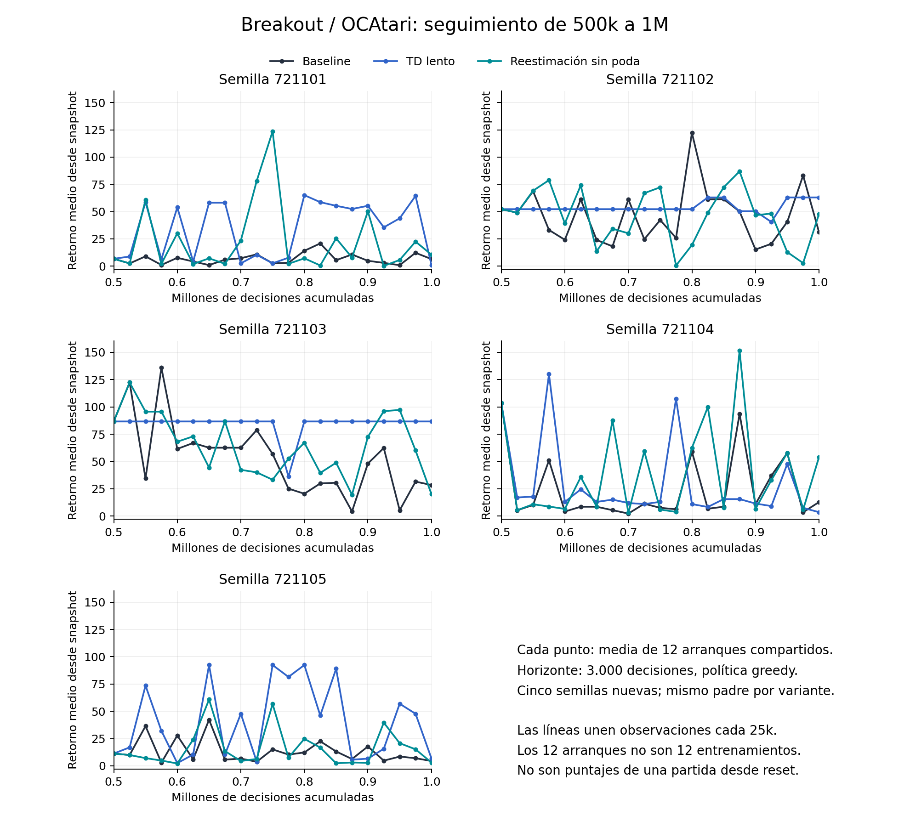

# Confirmación con semillas nuevas: baseline ANOVA, TD lento y reestimación

Campaña terminada y verificada el **10 de noviembre de 2026**. Se completaron cinco entrenamientos base hasta 1M, quince continuaciones de 500k a 1M, las 3.780 evaluaciones desde snapshots y las auditorías previstas. El test reservado permanece sin ejecutar.

**TD lento y reestimación vuelven a superar al baseline en la media de esta cohorte, pero ninguna intervención resuelve la inestabilidad.** El baseline termina con 16,65 puntos, TD lento con 32,23 y reestimación con 27,10. Cada intervención gana en tres de las cinco semillas y pierde en dos. El desempeño medio común al partir de 500k era 52,10: terminar por encima de un baseline deteriorado no equivale a aprender una política mejor que la inicial.

## Pregunta y diseño

La campaña anterior exploró siete variantes desde 500k hasta 600k. Mostró señales favorables para reducir el paso TD y reestimar Q, pero también dependencia fuerte de semilla. Esta campaña fijó antes de ejecutarse cinco agentes nuevos, **721101–721105**, y prolongó el seguimiento hasta 1M. No se eligieron parámetros ni semillas después de observar sus retornos.

Se conserva Breakout con OCAtari RAM, cuatro acciones, once relaciones, crecimiento ANOVA, descuento .99, recompensa de aprendizaje `sign(raw_reward)`, exploración .1 después del tramo inicial y profundidad máxima 4. Se entrenaron primero cinco baselines desde cero hasta 1M, guardando las historias completas y el checkpoint de 500k.

Desde cada checkpoint de 500k parten tres continuaciones:

| Variante | Actualización de Q | Mantenimiento adicional |
|---|---|---|
| Baseline | TD con paso .025 | Crecimiento original |
| TD lento | TD con paso .005 | Crecimiento original |
| Reestimación sin poda | TD con paso .025 | Reajuste periódico de Q cada 25k; crecimiento original habilitado |

El TD compartido actualiza la hoja correspondiente a estado y acción mediante

\[
q\leftarrow q+\eta\left[\operatorname{sign}(R)+.99\,m\max_a Q(s',a)-q\right],
\]

donde la máscara excluye el bootstrap en un terminal; el tratamiento de truncación y observación final conserva el contrato original. Reestimar modifica valores de las particiones existentes durante el mantenimiento, con buffer reciente de 8.192 transiciones y filtro de pérdida Bellman. No poda, no reemplaza y no mantiene congelada la estructura durante el aprendizaje online.

Cada continuación añade **500k decisiones**. El presupuesto es 7,5M transiciones nuevas en las continuaciones más 5M en los padres. La continuación baseline repite deliberadamente la segunda mitad de cada padre: el control debe reproducir exactamente **2,5M transiciones originales**.

Se evalúa sin aprendizaje ni exploración cada 25k, incluido el inicio: 21 puntos × 12 snapshots × 15 continuaciones = **3.780 rollouts**. Cada cifra promedia primero los doce arranques de una política congelada y después, con igual peso, los cinco agentes. El resultado principal es el endpoint fijado de 1M, no el mejor checkpoint observado.

**La métrica es puntaje bruto incremental desde un snapshot, con horizonte de 3.000 decisiones.** No es puntaje de una partida completa desde reset. Los arranques son tempranos y relacionados: aportan comparaciones pareadas de situaciones, no doce agentes independientes. Las cinco semillas de entrenamiento son la unidad de comparación. La nueva cohorte y el mayor horizonte de entrenamiento impiden comparar directamente sus medias con las de la campaña anterior.

Diseño: [confirmacion_anova_20261109.md](../../docs/confirmacion_anova_20261109.md). Configuraciones: [padres](../../configs/breakout_confirmation_parents_20261109.json) y [continuaciones](../../configs/breakout_anova_confirmation_20261109.json). Implementación: [confirm_rrtl_anova.py](../../experiments/confirm_rrtl_anova.py), [diagnose_rrtl_improvements.py](../../experiments/diagnose_rrtl_improvements.py) y [stable_revision.py](../../bayesian_rrtl/stable_revision.py). Esta comparación estudia variantes de RRTL ANOVA; no incluye BART, CART ni ExtraTrees.

## Resultado final y heterogeneidad

| Variante | Media final | Mediana entre agentes | Diferencia media contra baseline | Semillas mejores/iguales/peores |
|---|---:|---:|---:|---|
| Baseline |16,65|12,75|—|—|
| TD lento |32,23|6,83|+15,58|3/0/2|
| Reestimación |27,10|20,08|+10,45|3/0/2|

La media de TD lento es mayor, pero su mediana es menor que la del baseline. Dos semillas obtienen retornos altos y tres terminan en 1,17, 3,50 y 6,83. Por eso no debe resumirse el resultado como una mejora para el agente típico sin mostrar la distribución.

| Semilla | Padre a 500k | Baseline a 1M | TD lento a 1M | Reestimación a 1M |
|---|---:|---:|---:|---:|
|721101|6,75|6,50|1,17|10,58|
|721102|52,25|31,17|63,00|47,83|
|721103|86,67|28,42|86,67|20,08|
|721104|103,58|12,75|3,50|54,00|
|721105|11,25|4,42|6,83|3,00|



Bootstrap descriptivo pareado sobre las cinco semillas, 50.000 remuestreos:

| Contraste | Diferencia media | Intervalo percentil 95% |
|---|---:|---|
| TD lento − baseline |+15,58|[−5,35; 40,25]|
| Reestimación − baseline |+10,45|[−3,08; 26,50]|

Son intervalos descriptivos de una muestra pequeña, sin calibración por múltiples contrastes; no se presentan como una prueba confirmatoria de superioridad poblacional. Incluir cero tampoco demuestra equivalencia.

La semilla 721103 aporta el 74,8% de la ventaja neta de TD lento, y 721104 aporta el 78,9% de la de reestimación. Al excluir solo esas semillas, las diferencias medias restantes son todavía positivas, +4,92 y +2,75, respectivamente. Es un análisis de sensibilidad, no un motivo para eliminarlas del resultado principal ni una confirmación adicional independiente.

## Conservar desempeño y seguir aprendiendo son problemas distintos

| Cambio de 500k a 1M | Baseline | TD lento | Reestimación |
|---|---:|---:|---:|
| Media inicial común |52,10|52,10|52,10|
| Cambio medio hasta el final |−35,45|−19,87|−25,00|
| Semillas por encima del padre |0|1|1|
| Semillas iguales al padre |0|1|0|
| Semillas por debajo del padre |5|3|4|
| Semillas por debajo de algún pico observado |5|3|5|

La ventaja frente al baseline tiene, por tanto, un componente claro de conservación. En 721103, TD lento termina con los mismos 86,67 puntos del padre frente a los 28,42 del baseline. Sin embargo, tiene una caída intermedia hasta 36,17 a 750k antes de recuperar el resultado inicial: igualdad al final no significa estabilidad durante todo el seguimiento.

En 721102, TD lento sí mejora el padre, de 52,25 a 63,00, mientras baseline cae a 31,17. Es un caso favorable de progreso posterior. La otra cara es 721104: parte de 103,58 y termina en 3,50 con TD lento, peor que baseline. La tasa menor no protege todas las políticas.

La reestimación también conserva picos transitorios. En 721101 llega a 123,58 a 750k y termina en 10,58; en 721104 llega a 151,50 a 875k y termina en 54,00. Esos picos son observaciones de desarrollo, no retornos que podamos seleccionar retrospectivamente y reportar como resultado final de test.



Las escalas verticales son compartidas e incluyen todos los valores observados. Las líneas unen evaluaciones cada 25k: no localizan exactamente qué actualización causa una caída entre puntos.

Como comprobación adicional, los padres baseline también se deterioran al evaluarlos desde reset en las dos mismas semillas intermedias: medias de 44,60 a 500k y 14,20 a 1M. Las cinco evaluaciones finales adicionales de cada padre repiten los retornos obtenidos con esas dos semillas a 1M. Esa diversidad efectiva limitada impide tratarlas como muchas réplicas independientes. Las variantes intervenidas se compararon desde snapshots; no se ejecutó una nueva evaluación desde reset de TD lento y reestimación.

## Qué muestran las transiciones y los árboles

Se reconstruyeron las 1.500 ventanas de 5k decisiones y **12.929 episodios nuevos completos**. Se excluye de la media por episodio el segmento ya iniciado antes del fork. Las partidas no son réplicas independientes del experimento.

| Durante las 500k decisiones adicionales | Baseline | TD lento | Reestimación |
|---|---:|---:|---:|
| Puntaje bruto por 1.000 decisiones |28,37|33,01|28,38|
| Primeras 100k: puntaje por 1.000 decisiones |30,29|34,06|29,96|
| Últimas 100k: puntaje por 1.000 decisiones |28,91|31,59|26,55|
| Actualizaciones TD con argmax disjunto antes/después |4,42%|1,42%|4,53%|
| Crecimientos nuevos, suma de cinco agentes |61|28|49|

TD lento obtiene mayor recompensa de entrenamiento y produce menos cambios inmediatos de la acción maximizadora sobre los estados que visita. Es coherente con actualizaciones menores. Las variantes visitan distribuciones diferentes, por lo que esos porcentajes no constituyen una comparación sobre un panel común ni identifican un único mecanismo causal.

La reestimación tiene prácticamente la misma tasa de recompensa exploratoria que baseline, pese a su mayor media greedy final. No hay contradicción: el entrenamiento mantiene exploración .1 y actualiza el modelo; la evaluación congela una política greedy.

El criterio ANOVA permanece igual, pero bajar el paso también modifica las estadísticas acumuladas y las visitas: el crecimiento resultante es distinto. No se puede atribuir todo el contraste de TD lento únicamente a valores más suaves manteniendo fijo el árbol. Tampoco se puede atribuir el resultado de reestimación solo al mantenimiento: sus árboles siguen creciendo.

## Auditoría de las reestimaciones

Se registraron **114 propuestas, 93 aceptadas y 21 rechazadas**. Puede haber varias propuestas en un mismo mantenimiento, por lo que no equivalen a 114 experimentos independientes ni a 114 intervalos de entrenamiento. No hubo podas ni reemplazos.

La auditoría independiente reconstruyó las pérdidas y las distancias entre políticas de las 93 aceptaciones desde probes separados y pesos inmediatamente anteriores/posteriores. También verificó que el mantenimiento conservó la estructura, las identidades de nodos y sus estadísticas. La distribución de aceptaciones por semilla fue 19/20/15/20/19.

El filtro es de **no deterioro de pérdida dentro de un margen .0025**, no una obligación de reducir toda MSE observada. En 26 aceptaciones la MSE muestral candidata es mayor que la anterior. Por ejemplo, una primera reestimación de RIGHT en 721101 pasa de 0,103038 a 0,103183; el contraste por bloques permanece dentro del margen permitido. Eso concuerda con el diseño del filtro y no demuestra una mejora de política.

En este control `refit_only` tampoco se exige el filtro de distancia de política ni el de retorno. Diecinueve aceptaciones tienen distancia media de política superior a .05; el máximo es .16797 en las sondas guardadas. Se registran esas distancias, pero no rechazarlas es intencional en esta variante. No se confunde este control diagnóstico con la revisión protegida de la campaña anterior.

La auditoría certifica que se ejecutó y se registró la intervención prevista. No garantiza retorno futuro ni identifica una reestimación concreta como causa única de una caída posterior. No hemos demostrado sobreajuste como explicación general.

## Integridad, costo y reproducibilidad

- Cinco padres completos: **5M transiciones y 55 evaluaciones de desarrollo** verificadas en el cluster, incluyendo configuración, fuentes, cadenas de checkpoints, logs y bytes de los hitos retenidos.
- Integración técnica reducida: tres modalidades completas y 1.000 transiciones de control idénticas antes de preparar la campaña principal. Sus retornos no se mezclan con el resultado científico.
- Quince continuaciones completas: **7,5M transiciones, 3.780 rollouts y 2,5M controles exactos**. No faltan unidades.
- La comprobación local reconstruyó todas las trazas, sus hashes y las 1.500 ventanas; verificó evaluaciones contra sus checkpoints, identidades, semillas, horizonte y bancos disjuntos. Los catorce artefactos finales principales coinciden con SHA-256 capturados directamente del cluster.
- La auditoría de cambios aceptados se completó en Linux y queda enlazada al mismo manifiesto. Los pesos, probes y estados grandes del emulador permanecen en el cluster. La copia local incluye trazas, árboles exportados, metadatos, evaluaciones y reportes.
- El preflight terminó con **26 pruebas Linux** y una medición real de costo. No se presentan como aprobadas las pruebas locales que quedaron detenidas durante importaciones.

Todos los jobs principales terminaron `COMPLETED`, salida 0. Los cinco padres tardaron aproximadamente 60–65 minutos cada uno. Cada tarea de continuación ejecutó secuencialmente las tres variantes de una semilla, con sus evaluaciones y guardados: 2h22–2h54 por tarea. Esos tiempos no permiten atribuir un costo separado a cada método. Con concurrencia máxima dos, transcurrieron aproximadamente **10h46** entre el inicio de los padres y el fin del análisis, incluyendo integración, preparación y verificaciones finales. Las dos tareas gráficas posteriores solo generaron figuras; no ejecutaron RL.

Los IDs fueron padres38120, integración38121, preparación38122, continuaciones38123, reporte38124, análisis38127, auditoría38128 y auditoría de padres38132. [Registro Slurm en UTC](final_scheduler_snapshot_utc.txt); [hashes operativos](final_scheduler_snapshot.txt).

Fuentes científicas congeladas: `~/projects/rrl_confirmation_code_20261109_v2`; archivo fuente SHA-256 `ccd1a98eb65c40d085d9d0fc7cdc31e7ca0534819296dbe0ce2e7f4bdc602f8a`. Datos: `~/projects/rrl_confirmation_20261109_01`. Manifiesto de la campaña, hash del contenido: `47cc2276291ba5507aa097850cbd7e3d2332c6d09fa10e0fbd56d4fb6ef81664`.

La copia local está en `results_cluster/rrtl_confirmation_20261109_01`. Las figuras originales descargadas se conservaron; las del informe se regeneraron para separar leyendas y mostrar todos los picos con escala común. Esa corrección visual no cambia datos ni resultados.

Evidencia principal: [resumen verificado](final/verified_summary.json), [verificación de padres](final/parents_verification.json), [verificación local](final/local_data_verification.json), [auditoría de cambios](final/confirmation_guard_audit.json), [integridad de descarga](final/download_integrity.json), [diagnósticos por semilla](final/per_seed_diagnostics.csv), [entrenamiento](final/training_summary.csv) y [resumen ampliado](final/extended_summary.json).

Los scripts de cierre son [verify_parents.py](verify_parents.py), [verify_download.py](verify_download.py), [verify_results.py](verify_results.py), [analyze_complete.py](analyze_complete.py) y [plot_results.py](plot_results.py). Las fuentes científicas no se modificaron durante el cierre.

El [certificado de cierre](final/closure_verification.json) enlaza los requisitos con sus evidencias y hashes. Para reproducir el análisis desde la raíz del repo, con las dependencias disponibles:

```bash
export PYTHONPATH="$PWD"
RRL_DATA="results_cluster/rrtl_confirmation_20261109_01"
RRL_FINAL="analysis/confirmation_20261109/final"

python analysis/confirmation_20261109/verify_download.py \
  --campaign "$RRL_DATA/campaign" --analysis "$RRL_FINAL"
python analysis/confirmation_20261109/verify_results.py \
  --campaign "$RRL_DATA/campaign" --analysis "$RRL_FINAL" \
  --audit "$RRL_FINAL/confirmation_guard_audit.json" \
  --parents-verification "$RRL_FINAL/parents_verification.json" \
  --integration "$RRL_DATA/integration" --output "$RRL_FINAL"
python analysis/confirmation_20261109/analyze_complete.py \
  --campaign "$RRL_DATA/campaign" --output "$RRL_FINAL"
python analysis/confirmation_20261109/plot_results.py \
  --analysis "$RRL_FINAL" --output "$RRL_FINAL"
```

La verificación de padres y la reconstrucción independiente de reestimaciones ya se ejecutaron en cómputo con sus blobs presentes. Repetirlas requiere esas fuentes congeladas y datos del cluster; los cuatro comandos anteriores trabajan sobre la descarga y sus certificados. Los tres primeros también se ejecutaron localmente con Python estándar; la generación gráfica se ejecutó en Linux y sus imágenes se descargaron y comprobaron.

## Qué queda establecido y qué haría después

Esta campaña ya responde la pregunta propuesta con agentes nuevos y cinco veces más seguimiento que la anterior. La señal media favorable se repite para ambas intervenciones; la superioridad general y la estabilidad sostenida siguen sin demostrarse. TD lento es una intervención sencilla y favorable en varios indicadores, con fracasos claros que impiden adoptarla como solución universal. Reestimar tampoco reproduce una ventaja consistente entre todas las semillas.

No falta ejecutar más unidades para cerrar este experimento. Si se abre una etapa nueva, conviene estudiar las caídas con un panel fijo de estados reales y rutas/Q de las cuatro acciones, especialmente 721104 y los picos de 721101/721105. Un control con estructura congelada permitiría separar parte del efecto sobre valores del efecto posterior sobre crecimiento. Evaluar políticas congeladas con y sin exploración permitiría estudiar la discrepancia entrenamiento/greedy. Esos serían protocolos nuevos, con hipótesis y presupuestos propios; no se incorporan retrospectivamente a esta comparación ni se abre el test reservado para elegir una variante.
