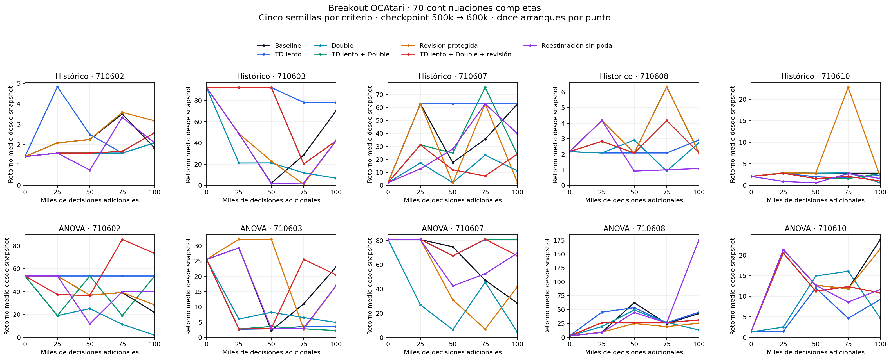
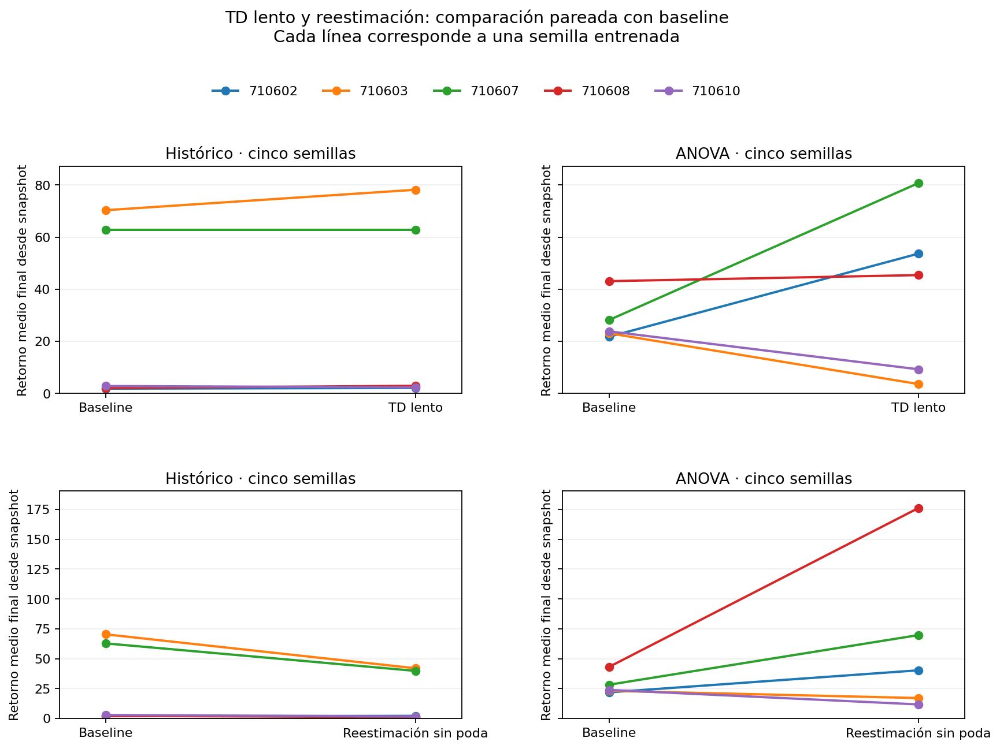

# Breakout OCAtari: cierre de la evaluación de mejoras RRTL

**Campaña completa y revisada el 9 de noviembre de 2026.** Terminaron las 70 continuaciones, 7 millones de transiciones nuevas y 4.200 rollouts de evaluación previstos. El reporte no tiene unidades faltantes, los controles reproducen exactamente 1 millón de transiciones originales y la auditoría independiente reconstruyó los 63 cambios de estructura o valores aceptados. Los archivos descargados coinciden con los hashes del cluster.

El resultado es heterogéneo. **Reducir el paso TD muestra una señal favorable sencilla; reestimar Q sin poda consigue la mayor media en ANOVA, influida fuertemente por una semilla; ninguna intervención mejora de forma consistente ambos criterios.** Double con paso .025 empeora claramente en esta configuración. Los controles de poda funcionan, pero aprobar una modificación inmediata no asegura conservar el desempeño mientras el agente sigue aprendiendo.

Este documento reemplaza como conclusión vigente al [corte parcial](review_20261109/informe.md). No se cambiaron parámetros tras observarlo ni se ejecutó el test reservado.

## Qué implementamos y qué evaluamos

El agente usa cuatro árboles relacionales, uno por acción, para estimar Q. OCAtari extrae pelota y paleta desde RAM y nuestro adaptador las convierte en relaciones. En cada transición se actualiza el valor de una hoja mediante TD; el criterio histórico o ANOVA decide cuándo añadir condiciones al árbol. Son variantes de RRTL. BART y los regresores CART/ExtraTrees de otros experimentos no forman parte de esta campaña.

El diagnóstico anterior encontró caídas con estructura fija y podas que mejoraban error Bellman pero perjudicaban las decisiones greedy. De allí surgieron los siguientes controles, fijados antes de ejecutar esta campaña:

| Variante | Paso TD | Bootstrap | Mantenimiento |
|---|---:|---|---|
| Baseline |.025|Q online|Crecimiento original|
| TD lento |.005|Q online|Crecimiento original|
| Double |.025|Selección online, valoración con bosque objetivo|Crecimiento original|
| TD lento+Double |.005|Selección online, valoración con bosque objetivo|Crecimiento original|
| Revisión protegida |.025|Q online|Poda/reemplazo y crecimiento|
| TD lento+Double+revisión |.005|Selección online, valoración con bosque objetivo|Poda/reemplazo y crecimiento|
| Reestimación sin poda |.025|Q online|Reajusta Q manteniendo estructura durante el mantenimiento; continúa el crecimiento original|

El bosque objetivo se copia cada 5k decisiones. La revisión, cada 25k, ajusta candidatas usando un buffer reciente y las compara con datos de validación separados. Una poda o reemplazo requiere pasar el filtro de error Bellman, el límite de cambio de política y una comparación de retorno desde seis snapshots de validación. Se acotan los valores propuestos al intervalo de predicciones anteriores observado durante el ajuste. Estos son controles operativos exploratorios, no garantías estadísticas de mejora de política.

La reestimación sin poda es un **control diagnóstico**, distinto de la revisión protegida: conserva particiones y estadísticas al reajustar las Q existentes, pero usa el filtro de pérdida sin exigir los otros dos controles. Permite separar el efecto de recalibrar valores del efecto de eliminar condiciones. Su crecimiento online sigue habilitado: no es un árbol permanentemente congelado.

Implementación: [stable_revision.py](../../bayesian_rrtl/stable_revision.py), [tree_revision.py](../../bayesian_rrtl/tree_revision.py) y [runner](../../experiments/diagnose_rrtl_improvements.py). Parámetros y fórmulas: [documento del diseño](../../docs/rrtl_mejoras_20261108.md) y [configuración congelada](../../configs/breakout_rrtl_improvements_20261108.json).

## Diseño y significado de las cifras

- Breakout con OCAtari RAM; criterios histórico y ANOVA; semillas 710602/603/607/608/610.
- Cada variante parte del mismo checkpoint de 500k de su grupo y continúa 100k decisiones. El punto final está en **600k**, no en 1M ni en 100k desde cero.
- Recompensa de entrenamiento `sign(raw_reward)`, descuento .99, exploración .1 y representación original. No se cambia la señal usada por el test de crecimiento.
- Evaluación greedy sin aprendizaje a 0/25k/50k/75k/100k adicionales, desde 12 snapshots compartidos, horizonte 3000. Son 12 estados físicos/RAM distintos y 10 codificaciones relacionales distintas; arranques tempranos y relacionados.
- El retorno es **puntaje bruto incremental desde el snapshot**, no puntaje de una partida completa desde reset. No se compara directamente con las evaluaciones históricas de 1M.
- Tres semillas por criterio fueron desarrollo de las revisiones; 710602/710608 se reservaron como confirmación respecto de ese desarrollo. No constituyen un benchmark ciego ni el test reservado del proyecto.

Cada media de las tablas promedia primero los 12 arranques de una política congelada y después, con igual peso, las cinco semillas entrenadas. Los 12 arranques no son 12 entrenamientos independientes. Ahora todas las variantes usan las mismas cinco semillas dentro de cada criterio.

## Resultados finales completos

| Variante | Histórico: retorno medio | ANOVA: retorno medio |
|---|---:|---:|
| Baseline |27.97|27.98|
| TD lento |29.65|38.53|
| Double |4.67|5.77|
| TD lento+Double |14.53|35.85|
| Revisión protegida |10.33|26.88|
| TD lento+Double+revisión |14.37|40.73|
| Reestimación sin poda |17.28|62.97|

El promedio parcial ANOVA, que usaba tres semillas completas, sugería 53.78 para la combinación de TD estable y revisión. Con las cinco queda 40.73. La nueva media mayor corresponde a reestimación sin poda, 62.97. Este cambio ilustra por qué no se eligió una variante ganadora a partir de la tabla incompleta.

Las escalas verticales varían entre paneles para poder leer las semillas de retorno bajo. Las líneas unen solo cinco mediciones y no describen el rendimiento entre ellas.

### Incertidumbre y heterogeneidad

Diferencias finales pareadas respecto del baseline del mismo criterio/semilla. Los intervalos son bootstrap descriptivo por las cinco semillas, 50.000 remuestreos, sin calibración por seleccionar varias intervenciones. No se interpretan como inferencia confirmatoria sobre agentes nuevos.

| Criterio | Variante | Diferencia media | IC95% descriptivo | Semillas mejores/iguales/peores |
|---|---|---:|---|---|
| Histórico |TD lento|+1.68|[−0.15;4.80]|3/1/1|
| Histórico |Double|−23.30|[−48.42;−0.08]|2/0/3|
| Histórico |TD lento+Double|−13.43|[−29.33;0.28]|1/1/3|
| Histórico |Revisión protegida|−17.63|[−41.70;0.33]|1/1/3|
| Histórico |TD lento+Double+revisión|−13.60|[−28.78;−0.07]|1/1/3|
| Histórico |Reestimación sin poda|−10.68|[−21.85;−0.55]|1/0/4|
| ANOVA |TD lento|+10.55|[−13.17;35.02]|3/0/2|
| ANOVA |Double|−22.22|[−26.38;−18.92]|0/0/5|
| ANOVA |TD lento+Double|+7.87|[−15.85;35.48]|2/0/3|
| ANOVA |Revisión protegida|−1.10|[−10.45;8.10]|2/0/3|
| ANOVA |TD lento+Double+revisión|+12.75|[−10.35;36.53]|2/0/3|
| ANOVA |Reestimación sin poda|+34.98|[−3.60;86.95]|3/0/2|

Ninguna variante favorable en ANOVA mejora todas sus semillas. Un intervalo que incluye cero no demuestra equivalencia; un intervalo negativo en esta cohorte tampoco establece que el método correspondiente sea perjudicial en cualquier configuración.

## Qué aprendimos de cada intervención

### TD lento: señal sencilla favorable, sin resolver todas las caídas

Al bajar solo el paso TD de .025 a .005, la media histórica pasa 27.97→29.65 y ANOVA 27.98→38.53. En ANOVA710602 el baseline cae 53.67→21.75 y TD lento conserva 53.67 en los cinco puntos. En 710607, el baseline empieza 81.00 y termina 28.17; TD lento termina 80.75. Estos casos muestran **conservación de desempeño existente**, no necesariamente aprendizaje de una política mejor que la del padre.

En cambio, ANOVA710603 termina 3.58 con TD lento frente a 23.08 del baseline, y 710610 termina 9.25 frente a 23.83. La tasa menor no elimina la dependencia de semilla.

Las trazas reproducidas muestran menos cambios inmediatos de argmax provocados por TD: histórico 6.54%→3.04% y ANOVA 2.01%→0.82%. Esto es compatible con pasos menores, pero las variantes visitan estados distintos; no equivale a medirlas en un panel común ni prueba estabilidad futura.

El puntaje exploratorio por mil decisiones durante la continuación es 20.74→24.24 en histórico y 30.57→29.95 en ANOVA. Mejor evaluación greedy y mayor recompensa durante entrenamiento son propiedades diferentes.

### Double: no aporta evidencia favorable en esta configuración

Double con paso .025 termina en 4.67 histórico y 5.77 ANOVA. Pierde frente al baseline en las cinco semillas ANOVA. Añadir Double a TD lento también reduce la media: 29.65→14.53 en histórico y 38.53→35.85 en ANOVA.

No se recomienda ampliar esta configuración sobre la base de estos resultados. Se probó una incorporación concreta de un objetivo copiado cada 5k sobre árboles ya entrenados; no se demostró que Double Q sea perjudicial en general ni que hubiese sobreestimación respecto del Q verdadero antes de incorporarlo.

### Reestimación sin poda: resultado nuevo favorable en ANOVA, concentrado

Esta variante obtiene 62.97 frente a 27.98 del baseline ANOVA. Mejora tres semillas y empeora dos:

| Semilla ANOVA | Baseline | Reestimación sin poda | Diferencia |
|---|---:|---:|---:|
|710602|21.75|40.25|+18.50|
|710603|23.08|17.00|−6.08|
|710607|28.17|69.75|+41.58|
|710608|43.08|176.17|+133.08|
|710610|23.83|11.67|−12.17|

La semilla 710608 aporta aproximadamente 76% de la diferencia neta agregada. Sus 12 retornos finales son 105/401/401/400/399/31/106/39/62/54/32/84: mediana 94.5, rango 31–401. Mejora diez arranques, empata uno y empeora uno frente al baseline. Hay una mejora extendida en ese banco junto con fuerte influencia de cuatro trayectorias de retorno cercano a 400. No es solo un rollout aislado, pero sigue siendo una única semilla de entrenamiento.

La curva de 710608 es 2.58→9.00→44.92→26.08→176.17; el salto grande aparece en el último punto. El mantenimiento aceptó tres reestimaciones y el crecimiento original añadió cinco divisiones, pasando de 91 a 96. **Sin poda no significa sin cambios estructurales por crecimiento**, ni permite atribuir el resultado final a una sola reestimación. Requiere confirmar el comportamiento durante una continuación posterior.

Sin 710608, la diferencia media de las otras cuatro semillas ANOVA es+10.46. Es una comprobación de sensibilidad, no una razón para excluir esa semilla del resultado principal. En el criterio histórico, reestimar pierde en cuatro de cinco y baja 27.97→17.28. No hay una mejora general compartida por los dos criterios.

### Poda y reemplazo protegidos: funcionan los filtros, persisten riesgos posteriores

La campaña produjo 187 crecimientos, 22 podas, 4 reemplazos y 37 reestimaciones. La auditoría independiente reprodujo los 63 cambios aceptados de las últimas tres clases a partir de pesos inmediatamente anteriores/posteriores y probes guardados. Verificó pérdidas, distancia entre políticas, acotamiento de valores propuestos y conservación de estructura/estadísticas o bosque objetivo, según la variante.

En las modalidades protegidas se registran 143 propuestas: 26 aceptadas y 117 rechazadas; 48 por pérdida, 64 por cambio de política y 5 por retorno. Son propuestas seleccionadas y dependientes, no 143 experimentos independientes. En 21 de las 26 aceptaciones protegidas permanecen iguales los seis retornos de validación inmediata. Son controles de no deterioro observado en esas situaciones, no evidencia de mejora global.

El histórico 710607 conserva el ejemplo del límite temporal. La modalidad protegida y su control tienen 25k transiciones idénticas hasta la primera poda. Inmediatamente después, ambas obtienen 62.75 de media. Tras seguir aprendiendo terminan 2.08 y 62.75; la revisada pierde en los doce arranques finales. El gate aprobado no protege la trayectoria futura, que incluye TD, visitas y recrecimiento posteriores. No atribuimos toda la caída final a un único cambio inmediato de Q.

En ANOVA, la combinación completa supera al baseline en 710602/710607 y pierde en 710603/710608/710610: la media sube a 40.73 pero empeora tres semillas. Además, el contraste que aísla añadir mantenimiento a `stable_td` da solo+4.88 puntos medios, con dos mejoras, dos empates y una pérdida. En histórico ese mismo contraste es−0.17, con una mejora, tres empates y una pérdida. Comparar únicamente la combinación completa con baseline mezclaría mantenimiento y cambios TD.

La revisión protegida con TD original termina en 26.88 ANOVA frente a 27.98 baseline y en 10.33 histórico frente a 27.97. Esta campaña no respalda que podar por sí solo resuelva la inestabilidad.

## Desarrollo y confirmación

La separación se conserva como se declaró antes de la corrida. Con ANOVA, las dos semillas de confirmación favorecen TD lento (+17.12 puntos medios) y reestimación (+75.79). Para revisión protegida con TD original la diferencia es−5.46, y para la combinación completa+20.04 con una semilla favorable y otra desfavorable. Double pierde en ambas.

La confirmación histórica es menos informativa sobre políticas buenas: sus dos baselines terminan cerca de 2 puntos; las diferencias son pequeñas. Los roles no justifican llamar a esta muestra un test ciego o extrapolar los dos éxitos de reestimación ANOVA a una población. [role_summary.csv](final/role_summary.csv) conserva los denominadores; el test reservado del proyecto continúa intacto.

La falta de estabilidad sigue siendo visible: cuatro de cinco semillas ANOVA de TD lento, revisión combinada y reestimación terminan por debajo de algún punto previo observado; el mismo conteo es cuatro de cinco en el baseline ANOVA. Elegir retrospectivamente el máximo de esas curvas no equivale a evaluar un selector de checkpoints en test independiente.

## Recuperación operativa e integridad

Se confirmó una cuota agotada de `archive` mediante una escritura que falló con `Disk quota exceeded`. Se preservaron las corridas originales y las fuentes congeladas. Solo se hicieron copias privadas de las dos unidades parciales en `~/projects/rrl_evaluation_recovery_20261109_02`; los resultados completos y bancos inmutables se consultaron desde sus rutas originales, sin abrirlos para escritura. Se verificaron los 63 estados originales antes/después y no cambiaron. El manifiesto, parámetros, entorno Conda y código científico conservaron su identidad.

| Job | Trabajo | Estado final | Tiempo |
|---|---|---|---|
|37899|Restauración de checkpoints y prueba de escritura|COMPLETED,0:0|34s|
|37900_8|Recuperación de ANOVA710608|COMPLETED,0:0|35m 35s|
|37900_9|Recuperación de ANOVA710610|COMPLETED,0:0|43m 33s|
|37901|Reporte completo e historias originales de control|COMPLETED,0:0|25m 42s|
|37902|Análisis de trazas y evaluaciones|COMPLETED,0:0|6m 08s|
|37903|Auditoría independiente de cambios aceptados|COMPLETED,0:0|1m 09s|

Los pasos de recuperación son [59](../../slurm/59_recover_rrtl_improvements.sh), [60](../../slurm/60_preflight_rrtl_recovery.sbatch) y [61](../../slurm/61_resume_rrtl_incomplete.sbatch); son cambios operativos separados de las fuentes científicas congeladas. Solo se cancelaron dos dependencias antiguas imposibles de satisfacer, de este mismo experimento. No se cancelaron jobs de otros proyectos.

El reporte del cluster restauró modelos, verificó entorno, bancos disjuntos, identidades, fronteras, propuestas y gates; los diez controles coincidieron exactamente con 100k transiciones originales por grupo: **1M en total**. El análisis verificó 7M filas, 1.400 ventanas de entrenamiento y 4.200 rollouts. La auditoría independiente reconstruyó 63 intervenciones, sin aprender ni ejecutar otro entrenamiento.

La revisión local comprueba los diez archivos finales contra SHA-256 del cluster, los sobres JSON con checksum, las 70 identidades de continuaciones, los 4.200 resultados de evaluación y sus checkpoints, y las trazas descargadas completas. Reproduce las 1.400 ventanas de entrenamiento y las contrasta con el CSV final. Se registran 17.757 episodios nuevos completos en las trazas; los episodios ya empezados en el padre se excluyen de esa cuenta. No son réplicas independientes del experimento.

Los blobs grandes de modelos, emulador y probes permanecen en el cluster y se auditaron allí. La copia local contiene trazas, estados, árboles exportados, reportes, CSV y figuras. [download_integrity.json](final/download_integrity.json), [local_data_verification.json](final/local_data_verification.json) y [closure_verification.json](final/closure_verification.json) conservan la evidencia y los límites de cada comprobación.

## Conclusión y continuación del proyecto

**La evaluación solicitada está cerrada.** No quedan continuaciones, rollouts ni auditorías pendientes dentro de este diseño. No se declara una política ganadora ni estabilidad general.

TD lento conserva la comparación favorable más sencilla, con mejoras y fracasos por semilla. Reestimación sin poda abre una hipótesis nueva en ANOVA que merece confirmación, junto con su dependencia de una semilla y su mal desempeño histórico. Double con paso .025 y la poda protegida aislada no tienen soporte favorable para ampliarse en su configuración actual.

Como trabajo posterior, separado de este cierre, conviene fijar una comparación entre baseline, TD lento y reestimación ANOVA con semillas nuevas, un horizonte de continuación mayor y situaciones más diversas; medir conservación de política, progreso adicional y caídas. Los experimentos para mejorar el efecto de la poda sobre TD futuro también deberán usar otra configuración/campaña. No se ajustaron gates ni se seleccionó un mejor checkpoint para reinterpretar esta misma evaluación.

## Archivos para reproducir la revisión

- [resultados.md](final/resultados.md):70 resultados por semilla/variante, medias, medianas y operaciones.
- [method_summary.csv](final/method_summary.csv):medias entre cinco semillas, diferencias e intervalos descriptivos.
- [incremental_ablations.csv](final/incremental_ablations.csv):controles que aíslan añadir Double o mantenimiento.
- [evaluations.csv](final/evaluations.csv), [matched_vs_baseline.csv](final/matched_vs_baseline.csv), [training_windows.csv](final/training_windows.csv):curvas, comparaciones por arranque y entrenamiento.
- [completion.json](final/completion.json), [auditoría independiente](final/campaign_guard_audit.json):cierre del análisis y 63 intervenciones reconstruidas.
- [verificador del resumen](recovery_20261109/summarize_complete.py), [verificador de descarga](recovery_20261109/verify_download.py), [figuras](recovery_20261109/plot_final.py):análisis local reproducible.

Manifiesto de la campaña:`5c68a97ac3ddd52553a705703ef4faf12d014108b41ca16e7b3b84d7eff805b4`. Fuentes científicas:`~/archive/rrl_improvement_code_20261108_v1`. Datos originales:`~/archive/rrl_improvements_20261108_01`. Recuperación y cierre:`~/projects/rrl_evaluation_recovery_20261109_02`. El [snapshot Slurm y hashes](recovery_20261109/final_scheduler_snapshot.txt) respalda el estado final.
