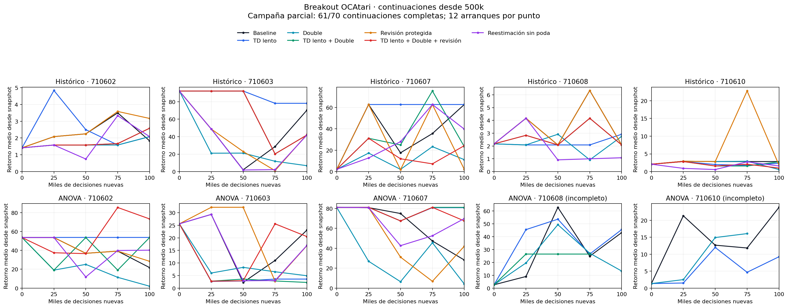
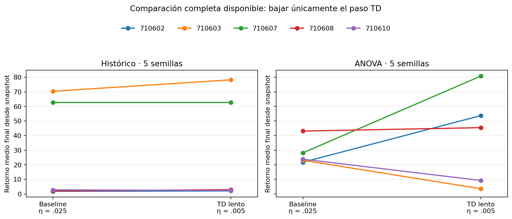

# Breakout OCAtari: revisión de resultados del 9 de noviembre de 2026

**Corte parcial conservado como registro. La campaña ya terminó; las conclusiones vigentes están en el [informe de cierre completo](../informe.md), con las cinco semillas de ambos criterios y la auditoría final.**

La campaña nueva está **parcial**: 61 de 70 continuaciones completas, dos parciales y siete sin iniciar. Hay señales favorables para reducir el paso TD, especialmente con ANOVA, pero ninguna variante demuestra una mejora general y estable. La revisión estructural funciona y sus controles se aplican; todavía puede empeorar el aprendizaje posterior. Double con el paso original obtiene resultados claramente inferiores en los casos terminados.

Se descargaron los metadatos, trazas, árboles JSON y logs nuevos. Los blobs de checkpoints y emulador permanecen en el cluster. Esta revisión no lanzó entrenamientos, modificó parámetros ni consumió el test reservado.

## Qué hemos hecho y qué pregunta responde cada etapa

1. **Baseline histórico y ANOVA hasta 1M.** Se ejecutaron diez semillas por criterio, con representación relacional de Breakout obtenida desde OCAtari RAM. Ambos aprenden, pero algunas políticas mejoran y luego se deterioran. En aquella evaluación de desarrollo, la media final fue 27.9 histórica y 58.4 ANOVA. Los protocolos de evaluación tienen limitaciones de diversidad y esos números no se comparan directamente con los retornos desde snapshots de esta campaña. El análisis anterior está en `analysis/baseline_anova_20261106/informe.md`.
2. **Diagnóstico de estructura y valores.** Desde checkpoints de 500k se compararon crecimiento normal, estructura fija con TD, poda, poda/recrecimiento y reemplazo: 30 continuaciones completas y 3M decisiones nuevas. Se observaron caídas aun sin nuevas divisiones. También una poda que mejoró MSE pero empeoró el retorno al elevar Q de FIRE. Por tanto, ni crecer menos ni reducir error Bellman aseguran una política mejor. Véase `analysis/revision_20261106/informe.md`.
3. **Mejoras prospectivas y controles.** Se implementaron siete variantes para separar paso TD, bootstrap con objetivo periódico, revisión protegida y reestimación de valores. Es la campaña revisada aquí. Es RRTL con cuatro árboles relacionales, uno por acción; las variantes BART/CART de otros experimentos no forman parte de esta comparación.

## Diseño de la campaña actual

Cada variante parte del mismo checkpoint de 500k para un criterio/semilla y continúa 100k decisiones: el punto final está en **600k**, no en 1M ni en 100k desde cero. Se conservan recompensa de entrenamiento `sign(raw_reward)`, descuento .99, exploración .1, representación y regla de crecimiento de cada criterio. No cambiamos la señal usada por el test de crecimiento.

| Variante | Cambio respecto de su control |
|---|---|
| baseline | TD .025 y crecimiento original |
| slow_td | Solo baja el paso TD a .005 |
| double_td | Paso .025; selecciona acción con Q online y valora con bosque objetivo copiado cada 5k |
| stable_td | Paso .005 más objetivo Double |
| guarded | TD original más poda/reemplazo protegidos |
| stable_guarded | TD .005, objetivo Double y revisión protegida |
| refit_only | Reestima Q durante mantenimiento sin podar ni reemplazar; el crecimiento original sigue habilitado |

La revisión ocurre cada25k, con ajuste usando entrenamiento reciente, validación Bellman por bloques, límite de cambio de política y comparación de retorno pareada desde seis snapshots separados. La evaluación reportada usa otro banco de **12 snapshots físicamente distintos**, con diez codificaciones relacionales distintas. El retorno es puntaje bruto incremental desde el snapshot y horizonte3000 decisiones; no representa una partida completa desde reset. Los puntos son 0/25k/50k/75k/100k adicionales.

Hay cinco semillas por criterio: 710602/603/607/608/610. 603/607/610 son desarrollo; 602/608 son confirmación respecto del desarrollo de las revisiones. No son un benchmark ciego. Los arranques siguen siendo tempranos y relacionados; no son doce entrenamientos independientes.

La propuesta, fórmulas y configuración se conservan en `docs/rrtl_mejoras_20261108.md` y `configs/breakout_rrtl_improvements_20261108.json`. El código central está en `bayesian_rrtl/stable_revision.py` y `tree_revision.py`; el runner en `experiments/diagnose_rrtl_improvements.py`.

## Qué terminó y qué falta

| Componente | Estado observado |
|---|---|
| Preparación37518 | COMPLETED;122 pruebas Linux e integración real reducida |
| Auditoría de integración37603 | COMPLETED; prueba adicional de reemplazo y reconstrucción de13 cambios aceptados |
| Array37604, grupos0–7 | COMPLETED; siete variantes por grupo |
| Grupo8: ANOVA710608 | FAILED, exit1, después de43m30s |
| Grupo9: ANOVA710610 | FAILED, exit1, después de29m49s |
| Reporte37605 | FAILED al inicio,0:53; sin output de reporte |
| Análisis37606 y auditoría37611 | Pendientes con DependencyNeverSatisfied; no se ejecutarán por sí solos |

No aparecen TIMEOUT ni OUT_OF_MEMORY en estas dos tareas. El máximo RSS registrado fue aproximadamente300–344MiB frente a8GiB solicitados, y el límite era8h. Los logs descargados no contienen el traceback que explique el exit1. El código0:53 del reporte y la ausencia de output aconsejan comprobar el acceso/escritura y las cuotas, pero esta revisión **no identificó la causa exacta**. El espacio global del NAS no verifica la cuota particular del usuario.

El estado de los resultados es:

- **61 completas**, dos parciales, siete sin iniciar.
- **6.285.000 transiciones guardadas y verificadas**, de7M previstas.
- **3.756 rollouts de evaluación completados y verificados**, de4.200 previstos.
- En ANOVA710608, `stable_td` llegó a100k adicionales y guardó checkpoint, pero no tiene evaluación final. Faltan iniciar `guarded`, `stable_guarded` y `refit_only`.
- En ANOVA710610, `double_td` guardó85k adicionales; faltan15k y su evaluación final. Faltan iniciar `stable_td`, `guarded`, `stable_guarded` y `refit_only`.
- Restan **715k decisiones nuevas y444 rollouts**, además del reporte y la auditoría final. Hay checkpoints desde los cuales continuar; no hace falta repetir las61 continuaciones completas.

## Resultados comparables entre todas las variantes

Para evitar que cada columna use agentes diferentes, la tabla usa solo semillas con las siete variantes terminadas: cinco históricas y tres ANOVA (710602/603/607). Cada cifra promedia primero los doce arranques de un agente y luego sus semillas. Las dos columnas no usan la misma selección de semillas y no estiman aquí la superioridad de un criterio sobre el otro.

| Variante | Histórico,5 semillas | ANOVA,3 semillas |
|---|---:|---:|
| Baseline |27.97|24.33|
| TD lento |29.65|46.00|
| Double |4.67|3.67|
| TD lento+Double |14.53|45.64|
| Revisión protegida |10.33|29.11|
| TD lento+Double+revisión |14.37|53.78|
| Reestimación sin poda |17.28|42.33|

Son resultados exploratorios de una campaña incompleta. No deben declararse ganadores a partir de la mayor media. Todos los puntos y resultados por semilla están en `curves.csv`, `final.csv` y `matched_vs_baseline.csv`.

### Reducir solo el paso TD: la comparación ya completa en cinco semillas por criterio

`slow_td` y su baseline terminaron en las diez combinaciones criterio/semilla; podemos compararlos sin esperar las variantes restantes.

| Criterio | Baseline | TD lento | Diferencia media pareada | Semillas mejores/iguales/peores |
|---|---:|---:|---:|---|
| Histórico |27.97|29.65|+1.68|3/1/1|
| ANOVA |27.98|38.53|+10.55|3/0/2|

Con ANOVA710602, la curva baseline cae53.67→53.67→36.92→39.25→21.75; TD lento conserva53.67 en los cinco puntos. En710607, el baseline cae81.00→80.75→74.83→47.25→28.17 y TD lento termina80.75. Son ejemplos de conservación del desempeño existente, no necesariamente aprendizaje adicional sobre la política inicial.

También hay fracasos: en ANOVA710603, TD lento termina3.58 frente a23.08 del baseline; en710610,9.25 frente a23.83. La mejora no es uniforme. Bootstrap descriptivo por las cinco semillas,50.000 remuestreos, da IC95%[−0.15;4.80] para la diferencia histórica y[−13.17;35.02] para ANOVA. Son intervalos post hoc descriptivos, no pruebas confirmatorias sobre una población nueva.

Las trazas muestran menos cambios inmediatos de argmax causados por TD: histórico6.54%→3.04% y ANOVA2.01%→0.82% sobre los estados visitados por cada variante. Es coherente con actualizaciones menores, pero las visitas también difieren; no es una comparación sobre un panel común ni una garantía de estabilidad futura.

Durante las100k de continuación, la tasa de puntaje de entrenamiento es20.74→24.24 puntos por mil decisiones en histórico y30.57→29.95 en ANOVA. La mejora greedy de ANOVA no coincide con una mejora de su tasa de recompensa exploratoria: son métricas y políticas diferentes.

### Double con el paso original resulta desfavorable

En histórico, la media final cae27.97→4.67. En ANOVA, las cuatro semillas con Double final completo pasan de29.02 en sus baselines pareados a6.06: pierde en las cuatro. El quinto Double está incompleto, no se le imputa cero.

En ANOVA710602/607, las curvas Double caen de53.67/81.00 iniciales a2.00/4.08 finales. Estos resultados desaconsejan ampliar esta configuración sin entenderla. No prueban que Double Q sea perjudicial en general: aquí se introdujo un objetivo copiado cada5k en árboles ya entrenados, con paso.025 y un horizonte particular. Paso, intervalo, generalización de hojas y crecimiento interactúan.

### La revisión protegida funciona, pero no asegura mejor aprendizaje

Se verificaron contadores y registros de **20 podas,3 reemplazos y32 reestimaciones**, además de142 crecimientos. Para las dos modalidades protegidas hay112 propuestas con gate registrado:23 aceptadas y89 rechazadas. Se rechazan42 por pérdida,45 por cambio de política y2 por retorno. No se cuentan como ensayos independientes.

Una candidata ANOVA710602 tuvo mejora media de retorno de validación+52.5 y aun así fue rechazada: uno de sus seis arranques perdía22 puntos, infringiendo el control por arranque. Esto confirma que no se acepta automáticamente cualquier aumento de media.

En20 de las23 aceptaciones protegidas, los seis retornos de validación permanecen exactamente iguales; en14 la distancia de política es cero sobre todas las sondas. Son simplificaciones que no cambian esas evaluaciones inmediatas, no pruebas de que la política global sea idéntica ni de que el aprendizaje posterior quede protegido.

El histórico710607 ilustra el límite. La modalidad protegida y su baseline tienen **25k transiciones idénticas**, incluidas acciones, TD, Q y recompensas, hasta la primera poda. A525k ambas políticas obtienen62.75 de media. Tras continuar aprendiendo, terminan2.08 y62.75 respectivamente; la podada pierde en los doce arranques finales. El gate inmediato aprobado no protege toda la trayectoria futura de aprendizaje. La caída posterior mezcla efectos de agregación de valores, TD, crecimiento y visitas; no se atribuye a un único cambio de Q inmediato sin más análisis.

Con ANOVA hay casos prometedores y resultados menos robustos de lo que sugiere la media:

- **710602, TD lento+Double+revisión:**73.42 frente a21.75. La mediana es38 y el rango4–349; mejora seis arranques y empeora seis. Su media alta tiene influencia de retornos extremos.
- **710607, misma variante:**67.42 frente a28.17; mediana68 y mejora11/12 arranques. Es un resultado más extendido dentro de ese banco, pero TD lento solo alcanza80.75: la combinación completa no domina a la intervención sencilla.
- **710603:**20.50 frente a23.08; mejora tres arranques y empeora nueve. No resuelve esta semilla.

El único caso ANOVA de confirmación con todas las variantes terminadas es710602;710608 está incompleto. No presentamos el promedio favorable de esas tres semillas como confirmación independiente suficiente.

## Qué podemos concluir y qué haría ahora

**Comprobado:** podemos observar los valores y árboles, podar, reemplazar y recrecer; los filtros de política y retorno rechazan candidatos; el aprendizaje puede deteriorarse aun con revisiones aprobadas. Reducir únicamente el paso TD es la hipótesis más sencilla que conserva una comparación completa y muestra señal favorable, con fallos claros por semilla. El objetivo Double con paso.025 no tiene soporte favorable en esta tanda.

**No comprobado:** una mejora general, convergencia, estabilidad sostenida, superioridad de poda protegida sobre TD lento, ni la causa única de cada caída. No hemos probado sobreajuste como explicación general. Los arranques y horizontes cubren una parte limitada del juego.

1. Identificar el fallo de ejecución y conservar stderr explícito; comprobar cuota y escritura antes de nuevos envíos.
2. Reanudar únicamente los grupos8/9 desde los checkpoints guardados y volver a encadenar reporte, análisis y auditoría. No reiniciar toda la campaña.
3. Cerrar las comparaciones en las mismas cinco semillas por criterio y completar la auditoría de pérdidas desde pesos/probes. No retocar umbrales usando estos resultados y llamarlo la misma confirmación.
4. Si la señal de TD lento persiste, contrastarlo con nuevas semillas y continuación más larga. Separar conservar una buena política de aprender una mejor. La revisión protegida requiere estudiar su efecto sobre las actualizaciones posteriores, no solo el gate inmediato.

## Integridad y archivos

`review_results.py` verifica checksums del manifiesto y de estados/evaluaciones, identidades de checkpoint,12 arranques por punto completo, semillas, horizonte, RAM disjunta de los bancos, contadores de eventos, gates registrados y continuidad/SHA/conteos de las6.285.000 transiciones. Los episodios iniciados antes del fork se excluyen de la media de episodios nuevos completos. Se contaron16.465 episodios nuevos completos en estas trazas; no son16.465 réplicas independientes del experimento.

Se comprobó igualdad del retorno inicial entre todas las variantes disponibles de cada grupo. Dos contrastes adicionales verifican25k transiciones idénticas antes de la primera intervención: histórico710607 `guarded` frente a baseline, y ANOVA710602 `stable_guarded` frente a `stable_td`; evidencia en `first_intervention_prefixes.json`.

Esta revisión local no deserializa checkpoints ni sustituye el reporte completo: todavía no reconstruye las pérdidas del gate a partir de pesos/probes ni certifica la equivalencia de1M transiciones de control con las campañas originales. La prueba Linux reducida anterior sí verificó2.000 transiciones exactas y13 cambios; no se extrapola esa auditoría a toda la campaña principal.

Fuentes congeladas: `~/archive/rrl_improvement_code_20261108_v1`. Datos: `~/archive/rrl_improvements_20261108_01`. Manifiesto:`5c68a97ac3ddd52553a705703ef4faf12d014108b41ca16e7b3b84d7eff805b4`. La evidencia Slurm está en `scheduler_snapshot.txt`. `summary.json`, `units.csv`, `curves.csv`, `final.csv`, `matched_vs_baseline.csv`, `pairwise_available_summary.csv`, `training_windows.csv`, `reviews.json` y `events.json` permiten comprobar denominadores, faltantes y cada comparación. `plot_results.py` genera las figuras. Los archivos originales no se sobrescribieron.
