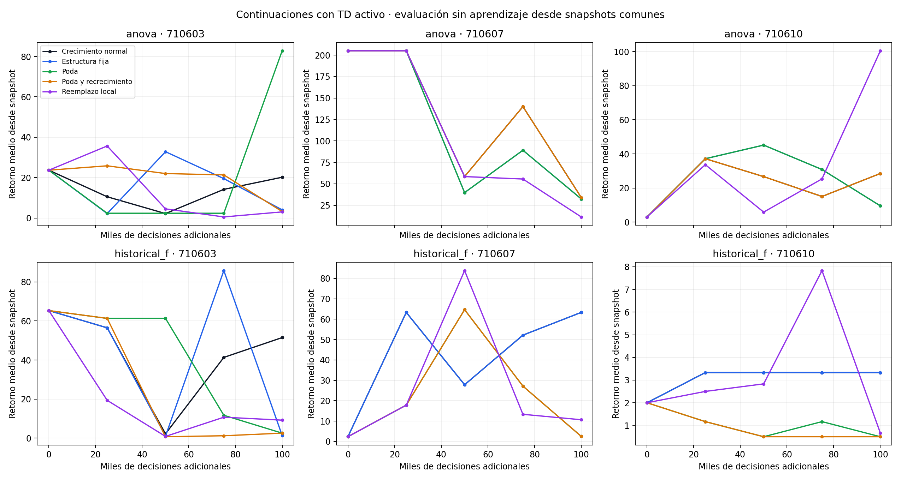
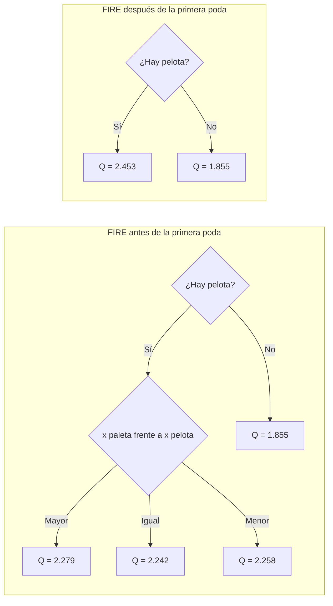
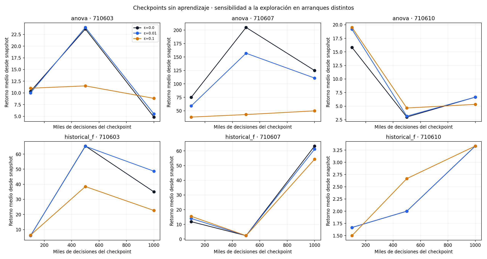

# Revisión de árboles RRTL: implementación y resultados diagnósticos

**Campaña completa, revisada el 8 de noviembre de 2026.** Se completaron las cinco modalidades, las 30 continuaciones, 3 millones de transiciones y 1.224 rollouts de evaluación, sin unidades faltantes. Los jobs de preparación, evaluación, entrenamiento y ambas auditorías terminaron con código cero. Los controles reproducen exactamente 600.000 transiciones de las corridas originales.

La revisión de árboles funciona operativamente. Su criterio de pérdida predictiva **no garantiza conservar el retorno ni la política**. Hay mejoras en casos concretos, caídas importantes y modalidades que rechazan todas las podas propuestas. Los tres seeds por criterio fueron seleccionados para diagnóstico: estos resultados no permiten declarar un método superior en general.

## Qué implementamos

El baseline estima un valor por acción mediante un árbol relacional. Si una situación llega a la hoja\(\ell(s,a)\), su predicción es\(Q(s,a)=q_{\ell(s,a)}\). El TD cambia ese valor:

\[
y_t=r_t+\gamma\mathbf 1_{\neg\mathrm{terminal}}\max_b Q(s_{t+1},b),\qquad
q_\ell\leftarrow q_\ell+0.025(y_t-q_\ell),\quad\gamma=0.99.
\]

La truncación conserva bootstrap cuando está disponible la observación final. Un terminal real no consulta el siguiente valor. La política de entrenamiento mantiene exploración\(\varepsilon=0.1\). La evaluación greedy no aprende y usa un stream separado para desempates.

`bayesian_rrtl/tree_revision.py` incorpora un fork diagnóstico con cinco modalidades:

| Modalidad | Cambia Q con TD | Permite crecimiento | Revisa ramas |
|---|---|---|---|
| `normal` | Sí | Sí, criterio original | No |
| `frozen` | Sí | No | No |
| `prune` | Sí | No | Sustituye un subárbol por una hoja |
| `prune_regrow` | Sí | Sí, con espera tras revisión | Poda y restaura candidatas para recrecer |
| `replace` | Sí | Sí | Propone un subárbol local con otra relación raíz |

`frozen` significa **estructura fija** en esta tabla. Una evaluación de checkpoint congelado, en cambio, mantiene fijos tanto estructura como Q.

La nueva hoja de una poda se ajusta a targets Bellman recientes; nunca recupera el Q antiguo del nodo padre. El reemplazo se ajusta por reducción de error cuadrático sobre targets, con profundidad local máxima 2 y profundidad global máxima 4. Conservamos ruteo por ausencia, catálogo de relaciones, enlaces padre/hijo, contadores e identidades persistentes de nodos.

## Qué test acepta una revisión

Cada 25k decisiones se prepara una referencia Q fija para comparar el árbol actual y la propuesta sobre los mismos targets. El ajuste usa únicamente el buffer reciente del entrenamiento. La validación procede de sondas de otro emulador y otro banco de arranques; nunca entra al TD.

Para cada bloque se calcula la diferencia de pérdida cuadrática candidata menos actual. Una cota bootstrap unilateral del 95%, con 400 remuestreos por bloques, debe ser menor que 0.0025 para podar o menor que −0.001 para reemplazar. Se exigen 128 ejemplos de ajuste, 64 de validación y al menos 4 bloques. Se revisan hasta 4 candidatas y se instala como máximo una por mantenimiento.

Es un criterio operativo exploratorio. Las sondas relacionadas, la selección de candidatas y la repetición de revisiones impiden interpretarlo como una garantía secuencial de significancia. El margen de poda permite cierto aumento de pérdida; tampoco una reducción de pérdida garantiza preservar las acciones greedy ni el retorno del juego.

## Diseño ejecutado e integridad

El runner es `experiments/diagnose_rrtl_revision.py`; la configuración está en `configs/breakout_revision_diagnostics_20261106.json`.

- Histórico y ANOVA, semillas 710603/710607/710610: seis casos elegidos para diagnóstico, no una muestra representativa nueva.
- Checkpoints originales 100k/500k/1M, exploración 0/.01/.1, seis arranques: 324 rollouts congelados.
- Desde 500k, cinco modalidades y 100k decisiones nuevas: 30 continuaciones, 3M transiciones.
- Evaluación a 0/25k/50k/75k/100k desde los mismos seis arranques: 900 rollouts adicionales.
- Horizonte 3000 decisiones por evaluación. El retorno es incremental desde un snapshot, no puntaje de una partida completa.
- Seis RAM y seis codificaciones distintas, construidas mediante prefijos reales reproducibles. Los seis arranques siguen siendo casos tempranos relacionados; no cubren todo Breakout.

Los padres y las campañas históricas permanecen intactos. Los controles normales se contrastan con sus continuaciones originales para detectar cualquier cambio de comportamiento introducido por la instrumentación.

Los seis controles normales coinciden exactamente con las 100k transiciones originales de cada caso, 600k en total, incluidos acciones, TD, recompensas y episodios. La evidencia final está en `final/control_equivalence_full.json`. La preparación pasó 107 pruebas Linux; después se ejecutó y auditó la campaña principal con los parámetros declarados. La integración reducida se conserva por separado y no aporta evidencia de eficacia.

El reporte principal verificó modelos, trazas, referencias Q, holdouts e identidades de evaluación. La auditoría posterior reprodujo las pérdidas de las **48 revisiones aceptadas** y comparó sus árboles antes/después. Las 14 primeras intervenciones efectivas tienen historias de aprendizaje idénticas a sus controles hasta el instante de intervenir. Los checksums del reporte, los scripts de análisis y las dos auditorías se comprobaron al descargar: `final/completion.json`, `final/policy_audit_completion.json` y `final/local_integrity_check.json` conservan la evidencia. Los blobs de modelos/emulador y holdouts permanecen en el cluster.

La evaluación usa seis RAM y seis codificaciones diferentes. El banco de validación tiene seis RAM y cinco codificaciones diferentes, sin RAM compartida con evaluación. Se verificó la restauración completa y la siguiente transición de cada snapshot. Los arranques son alcanzables y distintos, pero tempranos y relacionados; no representan toda la distribución de Breakout. No se ejecutó el test reservado.

## Comparación final de las cinco modalidades

Retorno bruto incremental medio desde los mismos seis snapshots, al terminar **100k decisiones adicionales desde el padre 500k**: estos checkpoints están en 600k. No son puntajes de partidas completas ni resultados del benchmark de 1M.

| Criterio | Semilla | Normal | Estructura fija | Poda | Poda y recrecimiento | Reemplazo |
|---|---:|---:|---:|---:|---:|---:|
| Histórico |710603|51.50|1.33|2.50|2.50|9.17|
| Histórico |710607|63.33|63.33|2.50|2.50|10.67|
| Histórico |710610|3.33|3.33|0.50|0.50|0.67|
| ANOVA |710603|20.17|4.00|82.83|3.17|3.00|
| ANOVA |710607|34.17|32.50|32.50|34.17|11.50|
| ANOVA |710610|28.50|9.50|9.50|28.50|100.50|

Las variantes de revisión terminan por debajo del control normal en los tres casos históricos. En ANOVA hay dos aumentos de media que requieren interpretaciones diferentes:

- **Poda, 710603:** los seis retornos son 14/14/13/351/4/101, frente a 25/25/24/25/4/18 del control. Mejora en dos arranques, empata en uno y empeora en tres. La media sube de 20.17 a 82.83, mientras la mediana baja de 24.50 a 14.00. El resultado depende de unos pocos rollouts altos.
- **Reemplazo, 710610:** obtiene 144/144/74/143/60/38, frente a 58/21/16/20/31/25. Mejora en los seis arranques; la media sube de 28.50 a 100.50. Sigue siendo una sola semilla de entrenamiento, evaluada en seis situaciones relacionadas.

En ANOVA710607/710610, `prune` acepta **cero** podas: coincide con estructura fija. `prune_regrow` también acepta cero podas y coincide con crecimiento normal. Por tanto, la diferencia entre poda pura y normal en esas semillas incluye desactivar el crecimiento; no se atribuye a eliminar ramas. Las candidatas con gate registrado fueron rechazadas por pérdida, no por una implementación que omitiera ejecutar el mantenimiento.

## Qué revelan las curvas y los árboles

### El crecimiento no es necesario para una caída

En histórico710603, los retornos medios del control normal a0/25k/50k/75k/100k adicionales son65.33/56.50/2.17/41.33/51.50. Con estructura fija son65.33/56.50/1.00/85.83/1.33. La segunda modalidad nunca crea una división: Q y la política pueden deteriorarse aun con estructura constante.

Esto no demuestra sobreajuste ni identifica por sí solo una causa única. Tampoco implica que el crecimiento sea inocuo: el control normal añade una división y después sigue otra trayectoria de aprendizaje.

### La primera poda puede mejorar pérdida y empeorar retorno

Se verificaron acciones, TD, recompensas, episodios, Q antes/después y rutas de las 25k transiciones anteriores a la primera poda, frente al control de estructura fija. Las tres semillas históricas coinciden exactamente en esos prefijos. La auditoría final amplía esa comprobación a las 14 primeras intervenciones efectivas: `final/revision_policy_effects.json`.

En710607, al llegar a525k se elimina una división de posición relativa jugador/pelota en la rama `FIRE/root/true`. La MSE de validación baja de0.059601 a0.021132; la cota de diferencia por bloques es−0.033464 y pasa el criterio. Sin embargo, el retorno medio desde los seis arranques pasa de63.33 en el control a17.83 en la política recién podada. En ese punto una única intervención separa los checkpoints, después de historias de aprendizaje idénticas.

Esto proporciona un contraste inmediato dentro de este caso y estos arranques. La caída final a2.50, tras más TD y otras tres podas, ya mezcla efectos posteriores; no la atribuimos íntegramente a aquella primera rama. Tampoco extrapolamos el resultado a todas las semillas ni a cualquier algoritmo de poda.

La comparación de los árboles JSON en 525k confirma que los otros tres árboles de acción no cambian. La rama `FIRE` cuando hay pelota pasa de tres Q entre 2.242 y 2.279 a un único Q=2.453; cuando no hay pelota conserva Q=1.855. La operación combina eliminación de una condición y reajuste de valores, no solo reduce el número de hojas. Estos valores proceden de pesos guardados inmediatamente antes y después del mismo mantenimiento. Evidencia: árboles y referencias de `final/revision_policy_effects.json`.

La auditoría cuantifica el cambio: la distribución greedy cambia en el **28.91%** de las sondas. Entre las sondas con pelota presente, la probabilidad greedy de FIRE pasa de 0% a **31.93%**. En los rollouts de evaluación, la fracción total de decisiones FIRE sube de **1.14% a 31.16%**. El retorno cae aun cuando mejora la MSE de esa acción.

La nueva Q queda por encima de los tres valores que reemplaza: no es solamente su promedio. Para separar el efecto de eliminar la condición del efecto de reajustar Q haría falta un control que reestime las hojas conservando la estructura. Este experimento identifica el efecto de la intervención conjunta; no demuestra sobreajuste ni permite atribuir todo deterioro posterior a una sola rama.

### Hay recrecimiento y reemplazo reales

Se registraron **32 podas, 16 reemplazos y 78 crecimientos**. Las 166 candidaturas con un gate registrado incluyen 48 aceptaciones y 118 rechazos; no son ensayos independientes. Cuatro podas no equivalen a la misma intensidad: histórico710610 pasa de 7 a 2 divisiones activas, mientras ANOVA710603 pasa de 104 a 96.

El recrecimiento se verificó por identidad de nodo: seis crecimientos ocurren en las propias hojas nuevas creadas por una poda, siempre después de la espera de 10k decisiones. Cinco reintroducen exactamente la relación eliminada; el sexto usa otra relación. Por ejemplo, `FIRE/root/more` de histórico710603 se poda en 525000 y recrece en 540393 con la misma relación de presencia de pelota previa. Evidencia: `final/regrowth_on_pruned_nodes.json`.

Por tanto, la implementación puede podar y volver a crear una decisión. Los resultados no muestran una mejora consistente por permitirlo: en ANOVA710603, la poda pura termina en 82.83 y poda/recrecimiento en 3.17. Cambian tanto la estructura como las trayectorias de TD y los datos visitados; esta diferencia final no aísla una única división responsable.

### Pérdida predictiva y política son objetos distintos

Las 48 revisiones aceptadas satisfacen el gate declarado y sus pérdidas fueron reproducidas sobre los mismos probes y la misma referencia Q. En 40 cambia la distribución greedy; la mediana de distancia de variación total sobre las sondas es 0.1172. Es una descripción sobre datos del propio gate, no una segunda validación independiente de su calidad.

Un error cuadrático pequeño en Q no impone conservar el orden entre acciones. Además, los targets usan estimaciones del propio modelo; no son el valor verdadero de las acciones. Por eso no se interpreta un gate aprobado como prueba de mejora de la política.

### Entrenar más no produce una mejora monótona

En los checkpoints congelados de ANOVA710607, la media greedy desde los seis snapshots es205.00 a500k y124.83 a1M; en710603 es23.67 y4.83. Son observaciones de estos casos, no una estimación poblacional. Cambiar\(\varepsilon\) también modifica los resultados: en710607/500k, pasa de205.00 con\(\varepsilon=0\) a43.00 con\(\varepsilon=.1\).

El entrenamiento exploratorio y la evaluación greedy también difieren. Por ejemplo, histórico710603/estructura fija acumula 29.05 puntos brutos por 1000 decisiones durante la continuación, pero su evaluación greedy final es 1.33. Las tasas de recompensa del entrenamiento no deben sustituir la curva de política sin aprendizaje. En histórico710610, las seis evaluaciones finales de cada variante de revisión llegan al límite de 3000 decisiones con retorno bajo: una larga duración o truncación no se toma como evidencia de buen juego.

## Qué señal está dividiendo el árbol

El crecimiento real sigue usando **Q actualizado**. La instrumentación acumula, por separado y sobre las mismas observaciones de cada ventana/candidata, Q actualizado, target TD y error TD. Los dos criterios nominales y el tamaño de efecto se exportan con soporte y ausencias.

El histórico evalúa una puntuación basada en la fracción de dispersión dentro/total; ANOVA usa la razón entre dispersión entre categorías y dentro de categorías con sus respectivos grados de libertad. Ninguno de esos contrastes sobre datos secuenciales garantiza utilidad futura de una división. Las puntuaciones de señales distintas ya discrepan en los primeros casos, pero eso no prueba que cambiar a targets o errores mejoraría la política.

Las ventanas diagnósticas se reinician cada5k. Las estadísticas reales del test de crecimiento se acumulan durante la vida de la hoja. Una candidata puede superar un umbral y seguir sin ser estructuralmente elegible; no confundimos conteos diagnósticos con divisiones realizadas.

Las seis continuaciones de control ya permiten una comparación completa de señales. En ANOVA710603 hay440 ventanas/candidatas con más de128 observaciones, al menos dos categorías y ambas puntuaciones definidas. Al aplicar ANOVA nominal con umbral0.0001 a las mismas observaciones,299 ventanas pasan solo con el target, una solo con Q actualizado y dos con ambos. La mediana de fracción de dispersión entre categorías es0.2497 para target y0.0116 para Q actualizado. Es una diferencia descriptiva de señales, no una prueba de que debamos dividir en esas299 candidatas: incluye restricciones de profundidad, fallback e historia que deben comprobarse por separado. No entrenamos aquí otra modalidad que cambie la señal real del test.

En total se auditaron **370.856 ventanas/candidatas** y los 78 eventos reales de crecimiento. Las repeticiones, la dependencia temporal y las candidatas no elegibles impiden tratar ese conteo como tamaño de muestra independiente. Los CSV conservan también el error TD, los efectos y las puntuaciones indefinidas; estas últimas no se imputaron como cero ni como un rechazo.

## Archivos para revisar el cierre

- `build_report.py`: trazas verificadas, curvas de aprendizaje, operaciones y comparación pareada con el control.
- `audit_signals.py`: comparación pareada de las tres señales, incluyendo puntuaciones indefinidas.
- `verify_controls.py`: equivalencia exacta con600k transiciones históricas de control.
- `audit_revision_effects.py`: reproduce la pérdida del gate y compara Q/acciones/árboles inmediatamente antes y después de cada operación; comprueba el prefijo anterior a la primera intervención.
- `final/continuation_summary.csv`, `final/matched_vs_normal.csv`: puntos de evaluación y diferencias pareadas por arranque.
- `final/training_windows.csv`: recompensa, episodios nuevos completos, cambios de argmax por TD, márgenes y fallback por ventanas de 5k.
- `final/revision_policy_effects.json`: los 48 cambios aceptados, con árboles antes/después, pérdidas y efectos inmediatos.
- `final/paired_signal_summary.csv`, `final/actual_growth_events.csv`: señales diagnósticas y evidencia de los eventos reales de crecimiento.
- `results_cluster/rrtl_revision_20261106_02/campaign/`: manifiesto, reportes, trazas y árboles JSON descargados; los blobs grandes permanecen en `~/archive/rrl_revision_20261106_02/campaign/` del cluster.

La auditoría de efectos usa las mismas sondas del gate, no otra validación independiente. El gap calculado con Q anterior es una estimación del propio modelo, no regret verdadero. La evaluación de retorno se mantiene separada.

## Qué haría después de este diagnóstico

1. Separar el reajuste de Q de la modificación estructural: comparar reestimación de hojas sin poda, poda con agregación de valores previos y la poda actual que ajusta targets. El caso FIRE muestra que ambos efectos están mezclados.
2. Evaluar candidatos también por cambios en las diferencias entre acciones y por retorno en un banco de validación separado; conservar una política anterior como control. Una restricción de ranking basada en Q estimada tampoco constituye por sí sola una garantía de retorno.
3. Contrastar Q actualizado, target y error TD en un conjunto de transiciones fijado, con las mismas candidatas y restricciones, antes de cambiar la señal del criterio de crecimiento.
4. Si una variante supera esos controles, ampliar a nuevas semillas y situaciones con parámetros fijados previamente. Los casos altos observados aquí sirven para formular hipótesis, no para elegir retrospectivamente una configuración ganadora.

Estas son propuestas posteriores. El experimento solicitado está ejecutado y revisado; no se cambiaron los umbrales después de observar sus resultados ni se lanzaron esas nuevas variantes.
